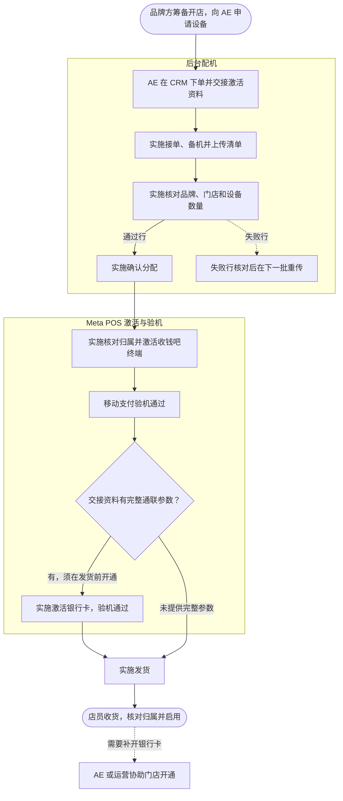
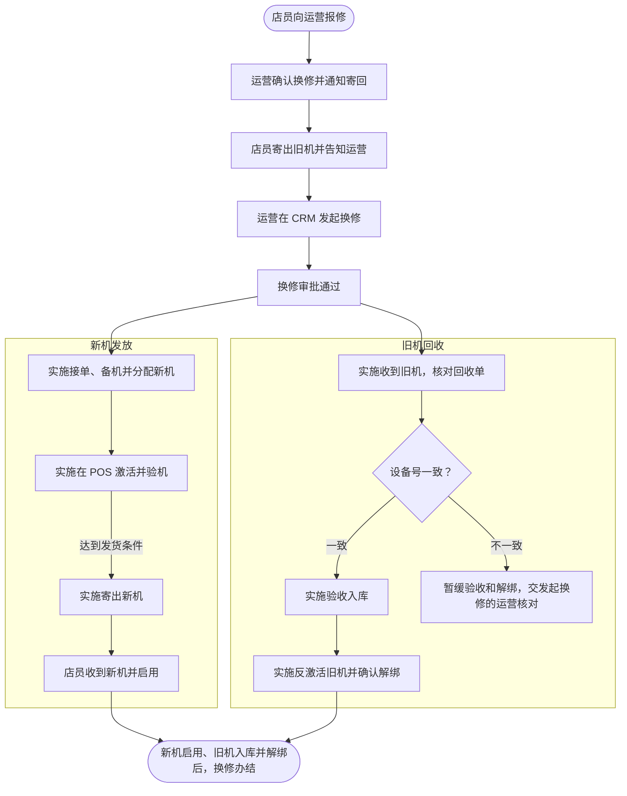
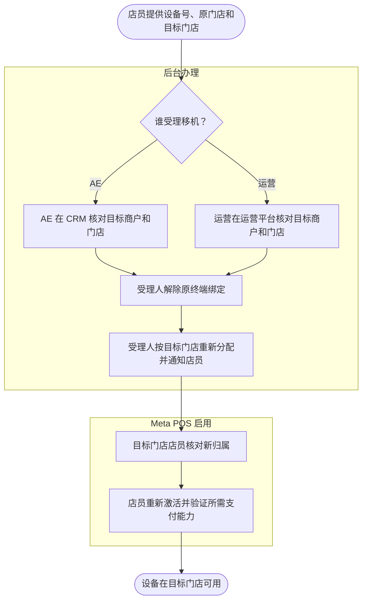
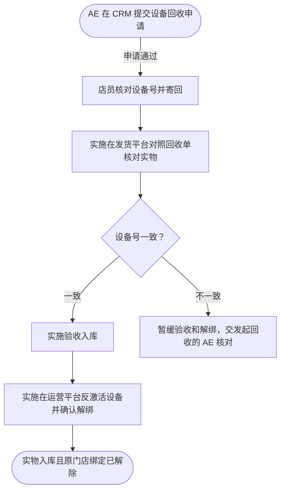
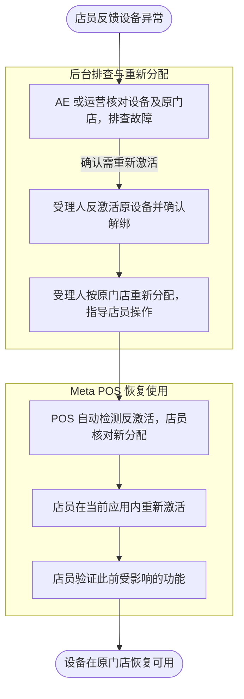
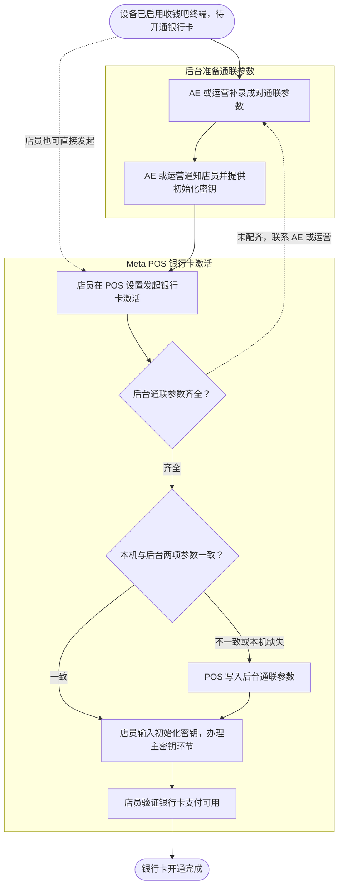

# Meta POS 设备分配与激活 BRD

V0.2｜2026-11-22｜业务方评审稿

面向收钱吧 AE、运营和实施。设备在激活前先分配到具体门店，实施据此核对设备归属和发货条件，AE 与运营据此协助门店完成移机、维护或到店后开通银行卡。

## 1. 业务现状与目标

Meta POS 目前按设备生成激活二维码，现场人员需要逐台扫码。实际发放新机和换修设备时，AE 或运营通过订单备注或派机清单交接目标门店和激活资料，实施按订单集中接单、备机、激活和验机，再寄出设备。逐台准备、查找并扫描二维码，与实施按批次处理设备的作业方式不匹配。

本期基于现有配机流程改造激活方式。实施备机后，用已有的订单和配机信息批量分配设备。POS 按设备号找到分配，现场人员核对归属后发起激活。AE 和运营也可为移机或维护办理单台分配，再交给店员在现场激活。

实施按订单交接的信息判断发货前要开通的支付能力。门店收到设备后可使用已开通的支付能力，需要开通银行卡时可在 POS 上继续办理。

## 2. 角色与端到端旅程

### 2.1 用户角色

| 参与角色 | 本期负责的业务 |
| --- | --- |
| 品牌方 | 筹备开店时向 AE 申请设备，提供目标门店和所需数量。 |
| 收钱吧 AE | 下单、发起回收，交接门店和激活信息。通过 CRM 办理单台移机、维护或协助开通银行卡。 |
| 收钱吧运营 | 受理故障、发起换修。通过运营平台办理单台移机、维护或协助开通银行卡。 |
| 收钱吧实施 | 接单、备机、批量分配、发货前激活和验机，以及旧机验收入库和解绑。 |
| 门店店员 | 接收和使用设备，报告异常，配合移机及寄回设备，在 POS 上重新激活或开通银行卡。 |

### 2.2 场景包一｜门店申请新设备

#### 高层用户旅程

##### 参与角色

品牌方、AE、实施、门店店员。银行卡待到店开通时，由 AE 或运营跟进。

##### 用户愿望

AE 希望下单时把配机信息一次交齐。实施希望按批次确认每台机器的目标门店和发货要求，让门店收到设备后就能使用。

##### 整体实现方式

AE 通过订单备注或派机清单交接门店和激活信息。实施在运营平台的「POS 设备分配」按批次办理，核对结果后在 POS 上完成激活和验机。

##### 用户旅程

1. 品牌方筹备开店时，向 AE 申请设备，说明目标门店和所需数量。
2. AE 在 CRM 下单，把目标收钱吧门店号、激活码和已有的通联参数交给实施。
3. 实施在 OMS 接单，在发货平台核对所需设备、目的门店和收件信息。
4. 实施备机后进入「POS 设备分配」，上传清单，按品牌、门店和数量核对，确认分配并查看逐台结果。
5. 实施逐台核对 POS 上的设备归属，完成收钱吧终端激活，再按第 3 节的发货条件验机。
6. 实施寄出验机通过的设备。银行卡待到店开通时，将事项交给 AE 或运营。
7. 店员收到设备，核对归属并使用已开通的支付能力。需要补开银行卡时，接续第 2.7 节。

##### 业务流程图

#### 子用户旅程

##### 1. AE 下单

| 步骤 | 用户 | 操作端 | 用户动作 | 用户看到或拿到的结果 |
| --- | --- | --- | --- | --- |
| 1 | AE | 业务协作 | 收到品牌方的开店配机申请后，确认目标门店和设备数量，准备对应的收钱吧激活码。 | 确认要给哪家门店配多少台设备。 |
| 2 | AE | CRM | 按确认的数量和发货信息提交设备订单。 | 拿到设备订单。 |
| 3 | AE | 订单备注或派机清单 | 把收钱吧门店号、激活码和已有的通联参数交给实施。 | 实施拿到订单及激活所需信息。 |

##### 2. 实施接单

| 步骤 | 用户 | 操作端 | 用户动作 | 用户看到或拿到的结果 |
| --- | --- | --- | --- | --- |
| 1 | 实施 | 运营平台-OMS+发货平台 | 收到订单后，查看待处理设备订单及 AE 提供的配机信息。 | 知道各订单的目标门店和设备数量。 |
| 2 | 实施 | 运营平台-OMS+发货平台 | 将订单推至发货平台，打开对应发货单。 | 拿到本次发货单。 |
| 3 | 实施 | 运营平台-OMS+发货平台 | 核对发货单中的设备数量和收件信息。 | 明确要备哪些设备、分别发给谁。 |

##### 3. 实施备机并分配

| 步骤 | 用户 | 操作端 | 用户动作 | 用户看到或拿到的结果 |
| --- | --- | --- | --- | --- |
| 1 | 实施 | 备机现场 | 按发货需求备机，核对机器标签上的设备号。 | 拿到可用于配机的实际设备号。 |
| 2 | 实施 | 运营平台-IOT 设备管理 | 进入「POS 设备分配」，选择收单机构选项并下载模板，填入设备号和 AE 交接的门店、激活信息后上传。 | 看到文件校验和门店匹配结果。 |
| 3 | 实施 | 运营平台-IOT 设备管理 | 按预览核对品牌、门店和每店设备数量，确认通过的设备分配。 | 能逐台确认设备分给了哪家门店。 |
| 4 | 实施 | 运营平台-IOT 设备管理 | 从批次列表查看分配结果。对失败行核对原因，整理后放到下一批重传。 | 知道本批哪些设备可开始激活，哪些需要重传。 |

##### 4. 实施激活并验机

| 步骤 | 用户 | 操作端 | 用户动作 | 用户看到或拿到的结果 |
| --- | --- | --- | --- | --- |
| 1 | 实施 | Meta POS | 打开已分配的设备，核对品牌、门店、设备号和银行卡终端参数。 | 确认手里的机器和分配信息对应。 |
| 2 | 实施 | Meta POS | 发起收钱吧终端激活，查看结果并验证移动支付。 | 确认设备的移动支付是否可用。 |
| 3 | 实施 | Meta POS | 订单已提供通联参数时，输入初始化密钥，完成银行卡激活并验机。 | 确认发货要求的支付能力是否齐备。 |
| 4 | 实施 | 发货现场 | 按第 3 节的发货要求核对验机结果。 | 确认这台设备能否发货，以及银行卡是否待到店开通。 |

##### 5. 实施发货

| 步骤 | 用户 | 操作端 | 用户动作 | 用户看到或拿到的结果 |
| --- | --- | --- | --- | --- |
| 1 | 实施 | 发货平台、发货现场 | 从待发设备中取出达到发货条件的设备，对照发货单核对门店和收件信息。 | 确认设备与发货对象一致。 |
| 2 | 实施 | 发货现场 | 按门店打包并寄出设备。 | 设备已寄往目标门店。 |
| 3 | 实施 | 业务协作 | 银行卡留待到店开通时，把设备和待办事项交给 AE 或运营。 | 接手人知道哪台设备还需协助开通。 |

##### 6. 店员收货启用

| 步骤 | 用户 | 操作端 | 用户动作 | 用户看到或拿到的结果 |
| --- | --- | --- | --- | --- |
| 1 | 门店店员 | 门店 | 收到设备后，确认收到的机器对应本门店。 | 店员知道哪台设备可在本店使用。 |
| 2 | 门店店员 | Meta POS | 查看设备归属，开始使用已开通的支付能力。 | 门店启用设备。需要到店补开银行卡时，进入场景包六。 |

### 2.3 场景包二｜门店换修设备

#### 高层用户旅程

##### 参与角色

门店店员、运营、实施。银行卡待到店开通时，由 AE 或运营跟进。

##### 用户愿望

运营希望确定什么时候可以发起换修。实施希望明确什么时候可以寄出新机，以及收到旧机后要完成哪些手续。店员收到新机后可以尽快恢复营业。

##### 整体实现方式

门店先寄出旧机，运营在 CRM 发起换修。申请通过后，实施分别处理新机发放与旧机回收。发新机时以运营本次交接的激活信息为准。

##### 用户旅程

1. 店员向运营报修，提供所属门店、设备号和故障情况。
2. 运营确认需要换修，告知店员要寄回哪台设备，以及如何寄回。
3. 店员核对设备号后寄出旧机，并告知运营。
4. 运营在 CRM 提交换修申请，把旧机、新机目标门店和本次激活信息交给实施。
5. 审批通过后，实施接单、备机并核对新机分配。
6. 实施在 POS 上按目标门店激活新机，完成发货前要求的验机。
7. 实施寄出已验机的新机。旧机可以仍在途中。银行卡待到店开通时，将事项交给 AE 或运营。
8. 店员收到新机，核对归属并使用已开通的支付能力。
9. 旧机到货后，实施核对设备号，验收入库并确认解绑。设备号与回收单有出入时，暂缓验收和解绑，交发起换修的运营核对。新机启用、旧机验收和解绑均完成后，换修办结。

##### 业务流程图

#### 子用户旅程

##### 1. 店员报修

| 步骤 | 用户 | 操作端 | 用户动作 | 用户看到或拿到的结果 |
| --- | --- | --- | --- | --- |
| 1 | 门店店员 | 门店 | 发现设备故障后，查看设备号并记下受影响的功能。 | 拿到可供运营排查的信息。 |
| 2 | 门店店员 | 业务协作 | 向运营反馈所属门店、设备号和故障表现。 | 运营能定位需要排查的设备。 |

##### 2. 运营确认换修并通知寄回

| 步骤 | 用户 | 操作端 | 用户动作 | 用户看到或拿到的结果 |
| --- | --- | --- | --- | --- |
| 1 | 运营 | 业务协作 | 接到报修后，按门店和设备号核对故障设备，确认需要换修。 | 确定本次需换修的旧机。 |
| 2 | 运营 | 业务协作 | 把待寄回设备和回寄要求告知店员。 | 店员知道要寄回哪台机器、如何寄回。 |

##### 3. 店员寄回旧机

| 步骤 | 用户 | 操作端 | 用户动作 | 用户看到或拿到的结果 |
| --- | --- | --- | --- | --- |
| 1 | 门店店员 | 门店 | 根据运营给出的信息核对实物设备号。 | 确认待寄回的机器与换修对象一致。 |
| 2 | 门店店员 | 门店 | 打包寄出旧机，并告知运营设备已寄出。 | 运营取得发起换修所需的寄回信息。 |

##### 4. 运营发起换修

| 步骤 | 用户 | 操作端 | 用户动作 | 用户看到或拿到的结果 |
| --- | --- | --- | --- | --- |
| 1 | 运营 | 业务协作 | 收到旧机已寄出的消息后，确认新机目标门店、收钱吧激活码和本次使用的通联参数。 | 拿到提交换修所需的新旧机信息。 |
| 2 | 运营 | CRM | 提交换修申请。已有本次使用的通联参数时一并提交。 | 换修申请进入审批。 |
| 3 | 运营 | CRM | 审批通过后，确认实施已取得发放新机和回收旧机所需的信息。 | 实施可以按换修订单与回收单接手。 |

##### 5. 实施接单

| 步骤 | 用户 | 操作端 | 用户动作 | 用户看到或拿到的结果 |
| --- | --- | --- | --- | --- |
| 1 | 实施 | 运营平台-OMS+发货平台 | 换修获批后，查看对应订单和回收单。 | 拿到新机发放和旧机回收的两份信息。 |
| 2 | 实施 | 运营平台-OMS+发货平台 | 核对新机去向和应收回的旧机设备号。 | 确认新机发往哪里，旧机到货后按哪张单验收。 |

##### 6. 实施备机并分配新机

| 步骤 | 用户 | 操作端 | 用户动作 | 用户看到或拿到的结果 |
| --- | --- | --- | --- | --- |
| 1 | 实施 | 备机现场 | 按换修订单准备新机，记下实际设备号。 | 拿到本次换修使用的新机。 |
| 2 | 实施 | 运营平台-IOT 设备管理 | 按运营本次提交的信息，核对设备号、目标门店和激活信息后确认分配。 | 能确认新机的待激活归属。 |

##### 7. 实施激活新机并验机

| 步骤 | 用户 | 操作端 | 用户动作 | 用户看到或拿到的结果 |
| --- | --- | --- | --- | --- |
| 1 | 实施 | Meta POS | 打开已分配的新机，核对设备和目标门店。 | 确认本机应激活到哪家门店。 |
| 2 | 实施 | Meta POS | 发起收钱吧终端激活并验证移动支付。 | 确认新机移动支付可用。 |
| 3 | 实施 | Meta POS | 本次已提供通联参数时，输入初始化密钥，完成银行卡激活并验机。 | 实施确认新机是否符合发货条件。 |

##### 8. 实施发出新机

| 步骤 | 用户 | 操作端 | 用户动作 | 用户看到或拿到的结果 |
| --- | --- | --- | --- | --- |
| 1 | 实施 | 发货平台、发货现场 | 确认换修已获批、新机已验机，并核对目标门店和收件信息。 | 确认可以发出新机。 |
| 2 | 实施 | 发货现场 | 寄出新机。银行卡待开通时，把事项交给 AE 或运营跟进。 | 门店等待收货，待开通事项有人接手。 |

##### 9. 店员收货启用

| 步骤 | 用户 | 操作端 | 用户动作 | 用户看到或拿到的结果 |
| --- | --- | --- | --- | --- |
| 1 | 门店店员 | 门店 | 收到新机后确认设备属于本次换修。 | 找到可替换故障设备的新机。 |
| 2 | 门店店员 | Meta POS | 核对门店归属，使用已开通的支付能力。 | 门店恢复使用。需要补开银行卡时，进入场景包六。 |

##### 旧机到货后 · 实施验收入库

| 步骤 | 用户 | 操作端 | 用户动作 | 用户看到或拿到的结果 |
| --- | --- | --- | --- | --- |
| 1 | 实施 | 发货平台 | 收到旧机后，按回收单核对实物及设备号。 | 确认实物与换修回收对象是否一致。 |
| 2 | 实施 | 发货平台 | 核对一致时完成验收入库。设备号不符时暂停办理该台设备，交发起换修的运营核对。 | 实施确认可继续办理解绑的设备。 |

##### 旧机验收后 · 实施解绑

| 步骤 | 用户 | 操作端 | 用户动作 | 用户看到或拿到的结果 |
| --- | --- | --- | --- | --- |
| 1 | 实施 | 运营平台-IOT 设备管理 | 旧机验收后，按设备号找到原门店下的设备。 | 确认需要解除的原绑定。 |
| 2 | 实施 | 运营平台-IOT 设备管理 | 办理反激活，查看原收钱吧终端解绑结果。 | 确认旧机已解除原门店绑定。 |

### 2.4 场景包三｜门店移机

#### 高层用户旅程

##### 参与角色

原门店和目标门店的店员、AE、运营。

##### 用户愿望

AE 和运营希望接到移机需求后，能确认设备当前属于谁、新的收款归属是什么，以及何时可以通知目标门店启用。

##### 整体实现方式

AE 通过 CRM 办理，运营通过运营平台办理。两者均可查看同一设备并接续处理。受理人先解除原归属，再为目标门店分配设备，由店员在 POS 上核对后激活。移机覆盖同一收钱吧商户及跨收钱吧商户的门店调动。

##### 用户旅程

1. 门店店员提出移机需求，向 AE 或运营提供设备号、原门店和目标门店。
2. 受理的 AE 或运营核对目标商户及门店，先解除原终端绑定，再按目标门店的激活信息重新分配。
3. 受理人通知目标门店继续办理。需要开通银行卡时，提供目标门店的通联初始化密钥。
4. 目标门店店员收到设备后，在 POS 上核对新归属并发起激活。需要开通银行卡时，在 POS 上输入初始化密钥。
5. 店员确认同一台设备在目标门店可用，完成移机。

##### 业务流程图

#### 子用户旅程

##### 1. 店员提出移机

| 步骤 | 用户 | 操作端 | 用户动作 | 用户看到或拿到的结果 |
| --- | --- | --- | --- | --- |
| 1 | 门店店员 | 门店 | 确认要调动的机器，核对设备号、原门店和目标门店。 | 明确要移动哪个设备、设备将去哪里。 |
| 2 | 门店店员 | 业务协作 | 向 AE 或运营提出移机并提供核对信息。 | 受理人取得设备号和两家门店的信息。 |

##### 2A. AE 办理归属变更

| 步骤 | 用户 | 操作端 | 用户动作 | 用户看到或拿到的结果 |
| --- | --- | --- | --- | --- |
| 1 | AE | CRM | 收到移机需求后，核对设备当前归属、目标收钱吧商户和门店，确认目标门店的激活信息。 | 知道要解除哪个绑定，以及设备应分给哪家门店。 |
| 2 | AE | CRM | 反激活原设备，核对原收钱吧终端解绑结果。 | 确认原门店绑定已解除。 |
| 3 | AE | CRM | 用目标门店的收钱吧激活码和本次通联参数创建新分配。 | 能确认新分配的目标门店。 |
| 4 | AE | 业务协作 | 通知目标门店店员核对设备并激活。需要开通银行卡时，提供初始化密钥。 | 目标门店店员知道在哪台设备上继续办理。 |

##### 2B. 运营办理归属变更

| 步骤 | 用户 | 操作端 | 用户动作 | 用户看到或拿到的结果 |
| --- | --- | --- | --- | --- |
| 1 | 运营 | 运营平台-IOT 设备管理 | 收到移机需求后，核对设备当前归属、目标收钱吧商户和门店，确认目标门店的激活信息。 | 知道要解除哪个绑定，以及设备应分给哪家门店。 |
| 2 | 运营 | 运营平台-IOT 设备管理 | 反激活原设备，核对原收钱吧终端解绑结果。 | 确认原门店绑定已解除。 |
| 3 | 运营 | 运营平台-IOT 设备管理 | 按目标门店的信息创建新分配，录入本次使用的激活信息和通联参数。 | 能确认新分配的目标门店。 |
| 4 | 运营 | 业务协作 | 通知目标门店店员核对设备并激活。需要开通银行卡时，提供初始化密钥。 | 目标门店店员知道在哪台设备上继续办理。 |

##### 3. 目标门店店员重新激活

| 步骤 | 用户 | 操作端 | 用户动作 | 用户看到或拿到的结果 |
| --- | --- | --- | --- | --- |
| 1 | 目标门店店员 | Meta POS | 收到设备和操作通知后，在当前应用内查看新分配，核对品牌、门店、设备号和银行卡参数。 | 确认机器对应目标门店。 |
| 2 | 目标门店店员 | Meta POS | 发起收钱吧终端激活，查看结果并确认移动支付可用。 | 设备可在目标店办理移动支付。 |
| 3 | 目标门店店员 | Meta POS | 本次有通联参数时，输入 AE 或运营提供的初始化密钥，完成银行卡激活并验证。 | 店员确认本次需要的支付能力可用。 |

### 2.5 场景包四｜门店设备回收

#### 高层用户旅程

##### 参与角色

AE、门店店员、实施。

##### 用户愿望

门店希望知道该寄回哪台设备。实施希望确认到货设备与回收单一致，并在入库后解除原门店的使用关系。

##### 整体实现方式

AE 在 CRM 发起回收，门店按回收要求寄回设备。实施在发货平台验收，并在运营平台处理解绑。

##### 用户旅程

1. AE 核对待回收设备和所属门店，提交回收申请。
2. 申请通过后，店员核对设备号，打包寄回设备。
3. 实施收到设备后，对照回收单验收入库。设备号有出入时，暂缓验收和解绑，交由发起回收的 AE 核对。
4. 实施解除已验收设备的原门店绑定，确认实物已入库且解绑完成。

##### 业务流程图

#### 子用户旅程

##### 1. AE 发起回收

| 步骤 | 用户 | 操作端 | 用户动作 | 用户看到或拿到的结果 |
| --- | --- | --- | --- | --- |
| 1 | AE | CRM | 核对待回收设备的设备号和所属门店。 | 确定本次要回收的实物。 |
| 2 | AE | CRM | 提交回收申请。 | 申请通过后，实施可按回收单接收设备。 |
| 3 | AE | 业务协作 | 把待寄回的设备和回寄要求交给门店。 | 店员知道该寄回哪台设备。 |

##### 2. 店员寄回设备

| 步骤 | 用户 | 操作端 | 用户动作 | 用户看到或拿到的结果 |
| --- | --- | --- | --- | --- |
| 1 | 门店店员 | 门店 | 按回收要求核对实物设备号。 | 确认要寄回的机器。 |
| 2 | 门店店员 | 门店 | 打包并寄回设备。 | 实施可在到货后按回收单核验。 |

##### 3. 实施验收入库

| 步骤 | 用户 | 操作端 | 用户动作 | 用户看到或拿到的结果 |
| --- | --- | --- | --- | --- |
| 1 | 实施 | 发货平台 | 收到设备后，打开对应回收单并核对实物和设备号。 | 知道收到的设备是否与回收单一致。 |
| 2 | 实施 | 发货平台 | 设备号一致时完成验收入库。设备号不符时暂停该设备的验收和解绑，交发起回收的 AE 核对。 | 确认实物回收结果和可继续解绑的设备。 |

##### 4. 实施解绑

| 步骤 | 用户 | 操作端 | 用户动作 | 用户看到或拿到的结果 |
| --- | --- | --- | --- | --- |
| 1 | 实施 | 运营平台-IOT 设备管理 | 验收通过后，按设备号核对待处理设备及其原门店。 | 确认要解除的原绑定。 |
| 2 | 实施 | 运营平台-IOT 设备管理 | 反激活原设备，查看收钱吧终端解绑结果。 | 确认已入库的设备解除原门店绑定。 |

### 2.6 场景包五｜门店设备维护

#### 高层用户旅程

##### 参与角色

门店店员、AE、运营。

##### 用户愿望

AE 或运营确认异常设备需要重新激活后，希望能在后台准备好原门店的新分配，指导店员在现场恢复使用。

##### 整体实现方式

AE 在 CRM 或运营在运营平台核对设备，解除原终端绑定后，为原门店重新分配设备。POS 自动发现变更，店员可以在当前应用内继续操作。

##### 用户旅程

1. 店员向 AE 或运营反馈异常，提供设备号、原门店和受影响的功能。
2. 受理人核对设备。确认需要重新激活时，解除旧终端绑定，按原门店完成新的分配。
3. 受理人指导店员继续操作。需要开通银行卡时，提供本次办理所需的初始化密钥。
4. 店员在 POS 上核对原门店和本次分配，重新激活收钱吧终端。此次配置有通联参数时，店员输入初始化密钥完成银行卡激活。
5. 店员确认受影响的功能已恢复，设备在原门店继续使用。

##### 业务流程图

#### 子用户旅程

##### 1. 店员反馈异常

| 步骤 | 用户 | 操作端 | 用户动作 | 用户看到或拿到的结果 |
| --- | --- | --- | --- | --- |
| 1 | 门店店员 | 门店 | 发现设备异常后，记录设备号、所属门店和受影响的功能。 | 拿到可供排查的信息。 |
| 2 | 门店店员 | 业务协作 | 把设备和异常情况反馈给 AE 或运营。 | 受理人可以定位设备及问题。 |

##### 2A. AE 排查并安排重新激活

| 步骤 | 用户 | 操作端 | 用户动作 | 用户看到或拿到的结果 |
| --- | --- | --- | --- | --- |
| 1 | AE | CRM | 收到设备异常反馈后，核对设备的原门店和绑定信息，确认是否需要重新激活。 | 明确该设备是否进入重激活流程。 |
| 2 | AE | CRM | 确需重新激活时，反激活原设备，核对原收钱吧终端解绑结果。 | 确认原绑定已解除。 |
| 3 | AE | CRM | 按原门店创建新分配，登记本次使用的激活码和银行卡参数。 | 能确认设备已分配到原门店。 |
| 4 | AE | 业务协作 | 指导店员查看新的分配并重新激活。需要开通银行卡时，提供初始化密钥。 | 店员知道本次在什么设备上继续操作。 |

##### 2B. 运营排查并安排重新激活

| 步骤 | 用户 | 操作端 | 用户动作 | 用户看到或拿到的结果 |
| --- | --- | --- | --- | --- |
| 1 | 运营 | 运营平台-IOT 设备管理 | 收到设备异常反馈后，核对设备的原门店和绑定信息，确认是否需要重新激活。 | 明确该设备是否进入重激活流程。 |
| 2 | 运营 | 运营平台-IOT 设备管理 | 确需重新激活时，反激活原设备，核对原收钱吧终端解绑结果。 | 确认原绑定已解除。 |
| 3 | 运营 | 运营平台-IOT 设备管理 | 按原门店创建新分配，登记本次使用的激活码和银行卡参数。 | 能确认设备已分配到原门店。 |
| 4 | 运营 | 业务协作 | 指导店员查看新的分配并重新激活。需要开通银行卡时，提供初始化密钥。 | 店员知道本次在什么设备上继续操作。 |

##### 3. 店员重新激活并验证

| 步骤 | 用户 | 操作端 | 用户动作 | 用户看到或拿到的结果 |
| --- | --- | --- | --- | --- |
| 1 | 门店店员 | Meta POS | 收到 AE 或运营的操作指引后，在当前应用内查看新分配，核对原门店和本次配置。 | 确认设备将恢复到原门店使用。 |
| 2 | 门店店员 | Meta POS | 发起收钱吧终端激活，查看结果。本次有通联参数时，输入初始化密钥并完成银行卡激活。 | 拿到本次激活结果。 |
| 3 | 门店店员 | Meta POS | 验证之前受影响的功能。 | 确认设备在原门店恢复使用。 |

### 2.7 场景包六｜门店自行激活银行卡

#### 高层用户旅程

##### 参与角色

门店店员、AE、运营。

##### 用户愿望

设备到店后已可使用移动支付。通联参数准备好后，AE 或运营希望能协助店员直接在现有设备上开通银行卡，沿用已激活的收钱吧终端。

##### 整体实现方式

AE 或运营在后台为在用设备补录通联参数。店员可随时从 POS 设置发起银行卡激活。POS 按当前设备已配置的参数继续办理，店员负责输入初始化密钥。

##### 用户旅程

1. AE 或运营接手待开通事项，核对门店和设备，补录成对的通联商户号和终端号。
2. 参数就绪后，AE 或运营主动通知店员，提供初始化密钥和操作指引。
3. 店员在 POS 设置中发起银行卡激活。如果看到参数待配置提示，联系 AE 或运营补齐后再发起。
4. 店员进入接收主密钥环节，输入初始化密钥并查看激活结果。
5. 店员验证银行卡支付可用，完成开通。

##### 业务流程图

#### 子用户旅程

##### 1A. AE 补录参数并通知门店

| 步骤 | 用户 | 操作端 | 用户动作 | 用户看到或拿到的结果 |
| --- | --- | --- | --- | --- |
| 1 | AE | CRM | 接手待开通设备后，核对目标门店、设备号和当前银行卡参数。 | 知道哪台设备还需配置。 |
| 2 | AE | CRM | 通联参数就绪后，为在用设备成对补录商户号和终端号。 | 能核对当前设备这次要使用的通联参数。 |
| 3 | AE | 业务协作 | 主动通知店员办理，提供初始化密钥和操作指引。 | 店员知道在哪台设备上发起银行卡激活。 |

##### 1B. 运营补录参数并通知门店

| 步骤 | 用户 | 操作端 | 用户动作 | 用户看到或拿到的结果 |
| --- | --- | --- | --- | --- |
| 1 | 运营 | 运营平台-IOT 设备管理 | 接手待开通设备后，核对目标门店、设备号和当前银行卡参数。 | 知道哪台设备还需配置。 |
| 2 | 运营 | 运营平台-IOT 设备管理 | 通联参数就绪后，为在用设备成对补录商户号和终端号。 | 能核对当前设备这次要使用的通联参数。 |
| 3 | 运营 | 业务协作 | 主动通知店员办理，提供初始化密钥和操作指引。 | 店员知道在哪台设备上发起银行卡激活。 |

##### 2. 店员发起银行卡激活

| 步骤 | 用户 | 操作端 | 用户动作 | 用户看到或拿到的结果 |
| --- | --- | --- | --- | --- |
| 1 | 门店店员 | Meta POS | 在当前在用设备上打开「设置 → 银行卡激活」。 | 看到接收主密钥界面或后台参数待配置提示。 |
| 2 | 门店店员 | 业务协作、Meta POS | 如看到参数待配置，联系 AE 或运营补录。收到通知后，再次从设置发起。 | 参数齐备后可继续办理主密钥。 |
| 3 | 门店店员 | Meta POS | 在接收主密钥环节输入初始化密钥并办理激活。 | 看到银行卡激活结果，设备继续沿用当前收钱吧终端号。 |

##### 3. 店员验证银行卡支付

| 步骤 | 用户 | 操作端 | 用户动作 | 用户看到或拿到的结果 |
| --- | --- | --- | --- | --- |
| 1 | 门店店员 | Meta POS | 取得银行卡激活成功结果后，验证本机的银行卡支付。 | 确认门店可以使用银行卡支付。 |

## 3. 本期范围与关键业务规则

本期涉及运营平台的批量和单台设备分配、CRM 的单台设备办理，以及 Meta POS 的现场激活和银行卡开通。下单、发货、实物回收通过现有业务入口办理。发货平台与终端管控的自动联动属于后续事项。

- **运营平台入口。** 实施和运营通过「集团客户 → IOT管理 → POS 设备分配」上传设备清单、筛选批次和查看分配结果。该菜单位于「POS激活管理」上方。
- **配机资料与核对。** 实施按「通联」或「暂不配置银行卡」选用清单。配机时要有收钱吧门店号、设备号和收钱吧激活码。通联商户号和终端号成对提供，也可同时留空。实施确认品牌、门店和设备数量后提交，并可查阅历史批次、分配结果和失败原因。通过的设备可先分配，有误的设备核对后放到下一批重新上传。
- **现场核对与撤销。** 设备按分配信息办理激活。同一台设备同一时间对应一条有效分配。现场人员核对品牌、门店、设备号和银行卡信息后再发起激活。发现待激活分配有误时，实施和运营可在运营平台撤销，AE 可在 CRM 撤销，现场人员可在 POS 上撤销本机的分配。POS 查不到分配时，联系 AE、运营或实施完成分配后重试。
- **发货前的支付要求。** 订单备注或派机清单成对提供通联参数时，实施完成移动支付和银行卡激活、验机后再发货。缺初始化密钥时，等银行卡激活完成。未提供完整通联参数时，可在移动支付验机通过后先发货，并在需要时由 AE 或运营协助门店后补。
- **解绑与再次启用。** 移机、维护先解除原终端绑定，再按本次分配重新激活。换修和回收的旧机由实施验收后解绑，设备留存的通联参数在下次激活时处理。有新参数则覆盖，仅开通移动支付时清除旧银行卡参数。
- **到店后单独开通银行卡。** 店员每次发起时，POS 核对本机与后台通联参数。两项一致时直接进入接收主密钥环节。后台已配置完整参数且本机有差异时，POS 带入后台参数，再继续初始化。

## 4. 成效与待确认

业务评审重点核对两类变化。第一，实施能按批次确认设备去向，并在发货前判断哪些设备可以交付。第二，门店能在新机到货、移机或维护后按确认的归属启用设备，待开通的银行卡可以在到店后办完。

建议用两项指标评估成效。实施对比同规模批次从配机到发货前验机完成的耗时。AE 和运营记录进入到店后补开流程的设备数，以及门店确认开通的设备数。基线、目标和观察周期由实施和运营共同确认。
