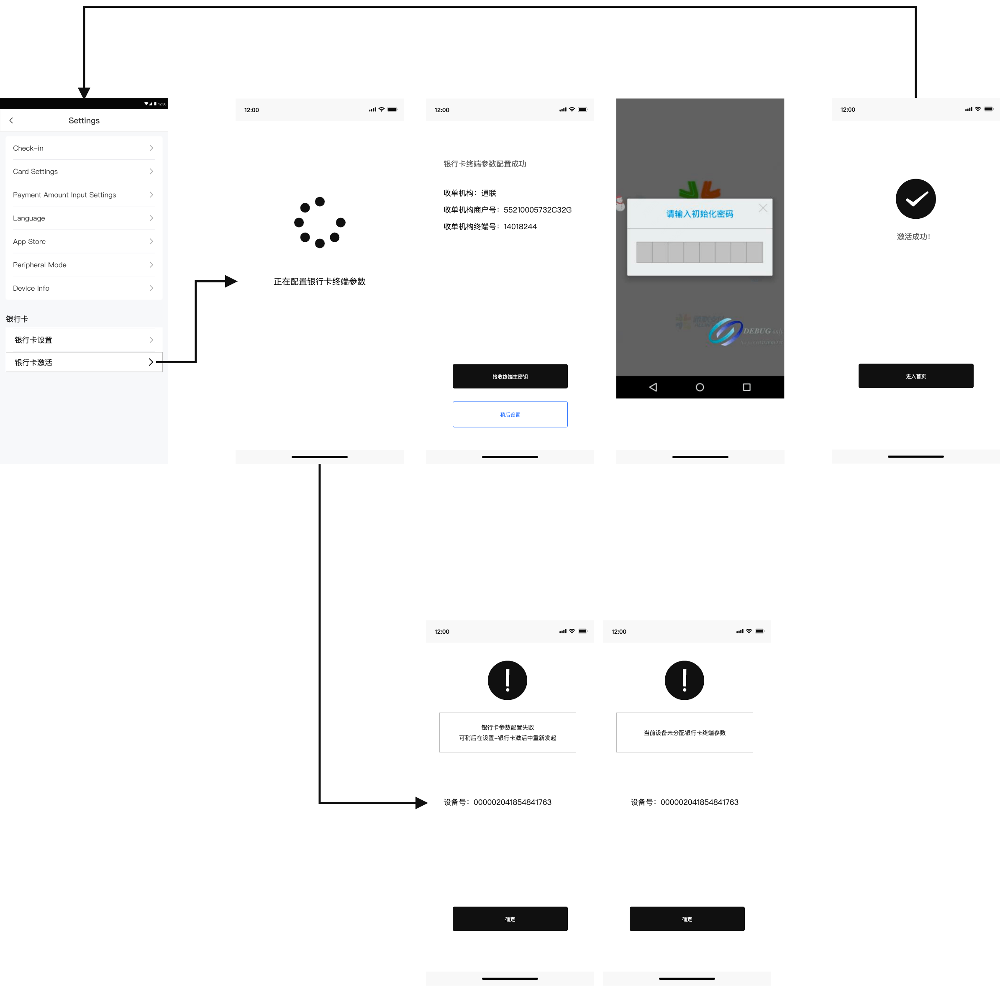

# Meta POS 设备分配与激活改造 PRD

| 版本 | 日期 | 状态 | 读者 |
|---|---|---|---|
| V0.1 | 2026-11-24 | 草稿 | 研发、测试、实施、运营、AE |

## 1. 方案概览

现有 Meta POS 依赖扫码激活，设备实际要分给哪家门店，通常在下单、派机和备机阶段已经确定。本期把这项确认前移到分配环节。实施、运营或 AE 先按设备号建立激活任务，现场人员在 POS 上核对归属后激活。收钱吧终端激活成功即可完成任务。通联银行卡按本次配置继续开通，也可以在已有收钱吧终端的设备上从设置页单独办理。

| 业务对象 | 含义与关系 |
|---|---|
| 设备号 | 实物 POS 的识别号，用于分配、现场查找和重新分配。始终按文本处理，保留前导零。 |
| 导入批次 | 运营平台一次上传对应一个批次。批次保留清单、检查结果、分配结果和逐台任务的聚合进度。 |
| 激活任务 | 分配成功后，每台设备生成一条任务。任务记录目标归属、收钱吧激活码和预分配的银行卡参数，保留历次激活结果。 |
| 已激活设备记录 | 新流程中，收钱吧终端激活成功且归属匹配后生成。设备 ID 标识本次设备记录，收钱吧终端号标识本次收钱吧终端。反激活后，实物设备可用同一设备号重新分配，历史任务和结果可查。 |
| 银行卡终端参数 | 预分配参数随激活任务交给 POS 使用。设备激活后的当前参数在设备详情维护。通联终端号与收钱吧终端号分别用于各自的业务。 |

**本期范围**覆盖运营平台的批次导入、任务和设备管理，Meta POS 端的设备与银行卡激活，以及 CRM 的单台分配、任务和设备管理。CRM 以当前销售或 AE 关联的品牌为数据范围。导入批次及整批执行留在运营平台。

新流程的 Meta POS 使用设备号查询任务，取消扫码激活入口。旧轻 POS 设备继续通过现有入口按原流程办理，存量设备迁移及旧流程改造留待后续。CRM 下单、OMS、发货、换修物流和实物回收继续走现有流程。本期通联银行卡开通支持 POS 写入通联 USDK，其他收单机构继续按现有方式配置。

业务场景和角色交接以 [业务 BRD](./meta-pos-device-activation-brd-business.md) 为背景。分配时生成任务、任务完成后生成设备记录、首次激活也先比对 USDK 参数、CRM 暂缓导入批次，采用后续确认口径。[运营平台 Demo](https://lch6s.github.io/spa/pos-device-allocation/)用于核对页面、字段和交互。生产数据由品牌门店关系、激活任务、收钱吧终端及设备服务提供，POS 激活和 USDK 处理由真实终端联调验证。

## 2. 端到端路径

### 2.1 实施同事

- **激活设备。** 接到新机或换修的配机需求后，在运营平台上传、检查并执行清单，或单台分配。拿到分配结果后，在 Meta POS 核对门店并激活收钱吧终端，按订单要求开通银行卡及验机。验机通过后发货，门店收货后使用已开通的支付能力。
- **反激活设备。** 收到换修或回收的旧机后，核对设备号和原门店，在运营平台「POS 激活管理」发起反激活。确认原终端解绑后，按现有换修或回收流程处理。需要再次发放时，为该设备创建新任务。

### 2.2 AE 同事

- **协助门店激活。** 在 CRM 核对品牌与目标门店，在所属品牌范围内创建单台激活任务，或查到已有任务，通知店员在 Meta POS 核对归属并激活。回到 CRM 确认任务已完成。遇到激活码异常时，按任务记录修正后通知店员重试。
- **反激活设备。** 接到移机、维护等需求后，在 CRM 查找当前设备并核对归属，办理反激活并确认原终端解绑。需要恢复使用时，按目标门店重新分配，再交给店员激活。
- **查看与维护设备信息。** 在 CRM 查看关联品牌内的设备详情和银行卡参数变更记录。需要后补通联时，成对补录商户号和终端号，通知店员并交接初始化密码。店员从 Meta POS 设置发起银行卡激活并验机。

### 2.3 运营同事

- **协助门店激活。** 在运营平台查找任务，按需要单台分配或继续处理导入批次。确认目标门店后，通知实施或店员在 Meta POS 办理。通过任务结果确认激活是否成功，按失败原因接续处理。
- **反激活设备。** 在运营平台「POS 激活管理」核对设备号及当前归属后发起反激活。确认解绑后，回收场景可结束设备办理。移机或维护场景按本次门店重新分配，再通知现场激活。
- **查看与维护设备信息。** 在运营平台查看设备归属、收钱吧终端、银行卡终端和设备上报信息。需要补录银行卡参数时，核对并保存，再通知现场从 Meta POS 设置继续。参数和操作记录可回查。

## 3. 产品需求

### 3.1 运营平台

实施和运营从「集团客户 → IOT 管理」使用「激活任务管理」和「POS 激活管理」。本模块中，实施与运营可处理全量品牌数据，操作记录到实际办理人。

#### 3.1.1 上传、检查与执行分配

「激活任务管理 → 导入批次」采用「上传 → 检查 → 执行」三步。一次上传对应一个批次。追加设备时新建批次。

1. **上传。** 选择刷卡收单机构、下载对应模板，可填写批次备注。清单支持 Excel 格式 `.xlsx`、`.xls`。可处理的清单进入「检查中」。文件无法读取、模板表头不符或没有设备行时，在上传页提示原因，操作人修正后重新提交。
2. **检查。** 按收钱吧门店号查询既有品牌门店关联，并校验必填项、编号格式、通联参数成对填写、文件内重复设备号及设备号占用。同一设备号在清单内重复时，相关行均列为检查未通过。同一设备号已有待处理任务或已关联有效设备时，显示冲突原因。
3. **核对预览。** 「设备分配预览」展示检查通过的行，按品牌 → 门店分组。品牌显示名称和编号，门店显示名称、编号及收钱吧门店号，展开后可查看设备号、清单行号和适用的银行卡参数。「检查未通过」显示行号、设备号、收钱吧门店号及失败原因。检查结果保留在原批次，离开页面后可通过批次列表继续核对。
4. **执行。** 操作人确认后执行检查通过的行。后台按确认过的目标归属再次核对门店关联与设备号占用。归属变化、设备已被其他人分配或其他执行异常时，记录该行失败原因。每条执行成功的行生成一条待处理任务。重复提交同一批次只返回已有执行进度或结果。

| 模板字段 | 通联 | 其他 |
|---|---|---|
| 收钱吧门店号、设备号、收钱吧激活码 | 必填 | 必填 |
| 通联商户号、通联终端号 | 两项一起填写或一起留空 | 模板无这两列 |

编号以文本保存并保留前导零。识别到科学计数法、长编号失真或额外字段时，提示原行及原因。激活码对目标门店的可预校验能力见 §5。收钱吧终端激活时必须校验实际归属，见 §3.2.2。

| 导入进度 | 含义及后续操作 |
|---|---|
| 检查中 | 清单已提交，逐行检查进行中。 |
| 检查失败 | 检查服务异常或中断，可以对原批次重试检查。 |
| 待执行 | 检查结束且至少一行通过。可继续核对并执行，也可取消。 |
| 执行中 | 系统正在完成分配并记录结果。 |
| 执行完成 | 已取得本批次逐条结果。存在检查未通过或执行失败的行时，仍可查看并导出这些行。 |
| 执行失败 | 执行服务异常或中断。先核对已处理结果，再对原批次重试，保留已成功行的任务。 |
| 已取消 | 全部行检查未通过时自动取消，或操作人在执行前确认取消。保留批次和已有检查结果，执行入口关闭。 |

实施或运营可凭批次号接手同事提交的批次。手动取消时记录操作人和时间，自动取消记录原因。进入执行阶段后，如需撤销已经分配的设备，通过对应激活任务作废办理。

#### 3.1.2 批次查询、详情与失败清单

- **查询。** 批次列表支持分页和重置。筛选项为批次号、批次备注、设备号、提交人、上传时间范围和导入进度。批次列表列顺序为批次号、文件名、批次备注、刷卡收单机构、导入进度、共导入、待激活、已激活、导入失败、已作废、提交人、上传时间、操作。时间筛选精确到分钟，包含起止分钟，可单填一端。结束早于开始时在时间条件处提示。
- **批次详情。** 执行后展示批次基础信息、进度统计和明细，下设「设备激活任务」「导入失败」。设备任务可按设备号、任务状态查找，操作规则与全局任务列表一致。取消、检查或执行中的批次进入相应阶段查看原因及进展。批次详情保留首次检查结果与最终执行结果各自的口径。
- **失败清单。** 「导入失败」合并检查未通过和执行失败，逐行给出失败阶段及原因。导出仅包含失败行，保留对应上传模板的字段顺序，末列增加「失败原因」。下载后可修正并作为新批次重传，系统忽略末列失败原因。本期通过重传修正导入失败的行。

| 批次统计 | 口径 |
|---|---|
| 共导入 | 本批次上传的非空设备行数，含后续检查未通过的行。 |
| 待激活 | 已生成任务、任务状态为「待处理」的设备数。可重试失败或结果待核对的任务计在这里。 |
| 已激活 | 本批次中任务已完成的设备数，反激活后仍保留该批次的历史完成结果。 |
| 导入失败 | 检查未通过与执行失败的行数。批次级服务异常由导入进度展示。 |
| 已作废 | 已生成任务且任务已作废的设备数，单独统计。 |

#### 3.1.3 单台分配与激活任务管理

**单台分配。** 在「设备激活任务」页打开单列弹窗。输入收钱吧门店号后，回显关联的品牌名称及编号、门店名称及编号和收钱吧门店号。再输入设备号、收钱吧激活码并选择刷卡收单机构。通联参数成对填写或成对留空。提交时核对设备号占用和门店归属。成功后弹窗提示「设备激活任务创建成功」，提供「返回」和「查看详情」，后者进入任务列表并显示新任务。

**分配校验和任务状态。** 批量执行和单台提交共用设备号占用规则。已有待处理任务或有效设备时，拒绝为同一设备号创建另一条有效任务。同一笔分配重复提交时沿用原结果。不同分配并发占用同一设备号时，只有一笔能创建任务。同一次激活重复返回成功结果时，只关联一条设备记录。

| 任务状态 | 进入条件及状态变化 |
|---|---|
| 待处理 | 配机分配成功后创建。激活码可修正的失败、临时故障、结果未知或待解绑仍在原任务处理。结果未确认期间，禁止重复激活或作废。 |
| 已完成 | 收钱吧终端激活成功且实际门店与任务目标一致。生成设备记录并回写任务结果。银行卡随后单独办理。 |
| 已作废 | 有权人员在后台，或现场人员在 POS，确认作废可处理的待处理任务。保留操作记录，释放该有效分配。 |

**任务列表。** 全局列表展示所有有效权限范围内的逐台任务，支持分页、搜索和重置。列表列为生成时间、设备号、目标品牌、目标门店、来源、批次号、任务状态、最近激活结果及操作。筛选项为设备号、品牌名称或编号、门店名称或编号、任务状态、来源、批次号、生成时间范围。时间筛选沿用批次列表的分钟及区间口径。

**任务详情。** 任务信息展示设备号、任务编号、状态、分配时间、批次号、作废信息及提交人。批次的提交人为上传人，任务的提交人为执行分配的操作人。目标门店展示品牌及门店名称、编号、收钱吧门店号和脱敏的收钱吧激活码。银行卡区域展示「预分配银行卡终端参数」。

| 操作 | 前置条件与结果 |
|---|---|
| 修改激活码、编辑预分配银行卡参数 | 任务待处理且当前无待核对激活结果或待解绑事项。保存到原任务。POS 重新检查后使用最新值。调整目标门店或设备号时，先作废原任务，再重新分配。 |
| 单条作废 | 在待处理行或任务详情发起，填写原因并确认。原任务保留结果，设备号可重新分配。 |
| 批量作废 | 批次详情与全局任务列表采用同一交互。默认隐藏勾选框，点列表上方「批量作废」后展示勾选框、已选数量、「选中全部」「全部取消」「确认作废」「取消操作」。全选针对当前筛选结果中的可作废任务，翻页保留勾选。确认前再次核对每台设备状态。已发起激活且结果待确认的设备等待结果，其余符合条件的设备照常作废。 |

**激活记录。** 每次尝试保留激活时间、结果、设备 ID、收钱吧终端号、原因、解绑情况及操作。设备 ID 与收钱吧终端号仅在成功记录显示。错绑失败原因包含实际错绑门店的收钱吧门店号。解绑情况仅在成功激活后又反激活的该条记录显示「已解绑」，其余显示「—」。错绑后系统自动解绑。结果未知或解绑未完成时，可在任务详情核对或重试解绑，确认解除后恢复原任务的可处理状态。成功且终端仍绑定时，可从该记录打开设备详情。运营平台和 CRM 读取实际激活结果，Demo 中的「模拟 POS 激活」及结果选择用于演示。

#### 3.1.4 POS 激活管理与银行卡参数维护

- **设备查询与详情。** 在现有「POS 激活管理」中按设备 ID、设备号、收钱吧终端号、品牌、门店及设备状态查询。列表展示状态更新时间、设备标识、设备类型、收钱吧终端号、应用版本、品牌、门店和状态。新流程的设备在激活成功后进入列表。详情展示设备信息、设备归属、收钱吧终端信息、银行卡终端信息及设备上报信息。激活记录在任务详情查看。
- **反激活。** 已激活设备从设备详情发起反激活并二次确认。确认原收钱吧终端解绑后，解除原设备记录上的有效设备号关联和银行卡配置，设备退出当前有效列表。历史任务保留设备 ID、原终端号和激活结果，成功记录显示「已解绑」。解绑失败或结果未知时先核对原结果，确认解绑后才允许重新分配。POS 上的续办见 §3.2.5。设备详情页移除删除入口。旧流程中未激活设备的列表操作沿用原有入口。
- **维护银行卡参数。** 在设备详情编辑本次在用配置。通联商户号和终端号须成对填写或一起留空。后台保存后的参数在现场下一次从设置页发起银行卡激活时读取。原任务的预分配参数保留为历史。
- **查看变更记录。** 记录变更时间、操作人、操作端、变更前和变更后的参数。首次由任务写入设备的配置记为系统初始配置，操作端显示「—」。手工维护记录实际操作人和端。变更前后按收单机构、商户号、终端号逐项分行显示。

### 3.2 Meta POS 端操作

#### 3.2.1 开始激活并核对设备归属

1. 实施或店员在未激活的 Meta POS 点「开始激活」。POS 按本机设备号查询有效的待处理任务。查无分配时，界面显示本机设备号并提示联系实施、运营或 AE。后台完成分配后，现场人员点「重试」。
2. 查到任务后，现场人员核对品牌及门店名称和编号、收钱吧门店号、设备号，以及本次预分配的银行卡终端参数。可点「重新检查」获取最新信息。
3. 信息正确时点「确认无误」，继续激活。信息有误时可二次确认作废本机待处理任务，等待后台重新分配。查询异常时可在 POS 上重试。

#### 3.2.2 确认并激活收钱吧终端

现场人员点「确认无误」后，POS 使用当前有效任务的收钱吧激活码发起，并显示「正在激活」。如果任务或确认过的内容已变化，现场人员需要重新查询并核对。收钱吧终端激活成功且实际收钱吧门店号与目标一致后，POS 显示收钱吧终端已激活，接着按 §3.2.3 处理银行卡参数。

| POS 上的结果 | 现场人员怎么继续 |
|---|---|
| 激活码无效、过期或已知属于其他门店 | 查看失败原因并返回激活入口。实施、运营或有权限的 AE 修正原任务后，现场人员重新检查并重试。 |
| 网络或服务超时，结果未知 | 等待上一次结果核对。确认成功后承接原结果，确认未激活后可重试。 |
| 收钱吧终端实际门店与目标不一致 | 看到激活失败。实际错绑门店号和自动解绑处理在任务详情查看。确认错绑解除后，现场人员可重新开始。 |

#### 3.2.3 收钱吧终端激活后的银行卡操作

收钱吧终端激活成功后，POS 使用本次激活任务的预分配参数。设备在移机、维护或重新发放后再次激活时，也按本节处理。

| 本次任务与本机 USDK 参数 | POS 行为 |
|---|---|
| 通联参数齐全，本机的商户号和终端号逐项一致 | 显示参数一致，跳过写入。现场人员可点「接收终端主密钥」或「稍后设置」。 |
| 通联参数齐全，本机缺失或任一项不同 | 成对写入本次任务的通联商户号和终端号。写入成功后显示配置结果，并提供「接收终端主密钥」和「稍后设置」。 |
| 本次无通联预分配参数 | 主动调用 USDK 清除本机旧通联商户号、终端号。确认清除后跳过主密钥环节，进入首页。空值或 `00` 以 §5 联调结果为准。 |
| 本机参数读取、写入或清除失败 | 提示对应的银行卡配置异常。写入失败可先使用已激活的收钱吧终端，后续从设置重新办理。清除失败时，须明确提示并避免沿用旧参数进行银行卡收款，终端拦截方式见 §5。 |

现场人员选择「接收终端主密钥」后，在通联界面输入初始化密码。主密钥接收成功才显示「银行卡激活成功」。选择「稍后设置」时，显示收钱吧终端已激活及银行卡待开通，现场可进入首页。主密钥办理失败或中断时，可从设置续办。任务仍以收钱吧终端激活结果为准。

交付给门店前，实施按订单备注或派机清单验机。已提供成对通联参数时，须完成收钱吧终端和银行卡的激活及验机后发货。缺初始化密码的设备等银行卡开通后发货。未提供完整通联参数时，可在收钱吧终端激活并验机后先发货，后续由 AE 或运营协助门店开通。

#### 3.2.4 设置页单独发起银行卡激活

收钱吧终端已激活后，现场人员可从「设置 → 银行卡激活」发起。每次发起都读取**当前设备详情维护的最新银行卡终端参数**，并逐项与本机通联 USDK 比对。

| 参数或结果 | POS 行为 |
|---|---|
| 当前设备未配置完整通联参数 | 展示设备号及「当前设备未分配银行卡终端参数」。AE 或运营补录后通知现场再次发起。 |
| 当前参数齐全且两项都一致 | 直接进入「接收终端主密钥」。 |
| 当前参数齐全但本机缺失或任一项不一致 | 成对写入当前设备参数。写入成功后进入「接收终端主密钥」。失败时告知现场可稍后从设置重试。 |
| 主密钥接收成功 | 显示「银行卡激活成功」，现场可验证刷卡。办理全程沿用当前收钱吧终端号。 |

设置页发起的成功、稍后办理和异常确认后回到设置。图中成功页的「进入首页」按钮按此去向改为「返回设置」。

#### 3.2.5 设备反激活后在 POS 重新办理

运营平台或 CRM 完成反激活后，POS 自动检测到变化并回到未激活页面，现场人员无需重启。收到重新分配的通知后，按 §3.2.1 从「开始激活」核对本次归属和银行卡参数，再完成激活。设备已回收时，现场停在未激活页面。

### 3.3 CRM

#### 3.3.1 激活任务管理

CRM 提供「激活任务管理」菜单，进入后展示设备激活任务列表。当前销售或 AE 可在授权品牌范围内单台分配、查看任务及结果、编辑待处理任务的激活码和预分配银行卡参数，并单条或批量作废。单台分配、作废及状态规则沿用 §3.1.3。

运营平台批量生成的任务按各自目标品牌进入 CRM 列表，可用批次号辅助排查。CRM 展示来源批次号作为查询线索。批次导入、批次详情、整批执行和失败清单下载在运营平台办理。

#### 3.3.2 POS 激活管理

CRM 提供「POS 激活管理」菜单，销售或 AE 可在授权品牌范围内查询已激活设备与详情、办理反激活、维护银行卡终端参数并查看变更记录，设备操作规则沿用 §3.1.4。记录实际操作人为当前登录用户，操作端为 CRM。反激活与参数补录交接的结果分别按 §3.2.5 和 §3.2.4 在 POS 上继续处理。

#### 3.3.3 品牌数据权限

数据范围为当前登录销售或 AE 已关联的品牌。品牌范围内可查询其他同事创建的任务和设备。服务端在列表、详情直达和每次操作提交时校验当前权限。

| 对象或操作 | 校验依据与结果 |
|---|---|
| 查询、编辑、作废激活任务 | 按任务目标品牌过滤。权限变更后再次访问或提交，使用最新品牌关系。 |
| 查询设备、反激活、维护银行卡参数及查看变更记录 | 按设备当前归属品牌校验。 |
| 单台分配 | 按收钱吧门店号解析目标品牌。目标门店超出当前范围时，提示不可操作并终止提交。 |
| 批量作废 | 每条任务分别校验品牌与任务状态。只处理符合条件的任务，反馈未处理的数量和原因。 |

CRM 错绑原因涉及未授权的实际门店号时，其字段是否对有权查看任务的 AE 可见见 §5。评审稿按该字段受品牌数据范围校验处理。

## 4. 关键验收

| 对应能力 | 条件 | 动作或事件 | 可观察结果 |
|---|---|---|---|
| §3.1.1 多门店清单 | 清单中有多个有效品牌门店 | 上传并检查 | 预览按品牌、门店分组，名称、编号、收钱吧门店号与有效归属一致。 |
| §3.1.1 全部未通过 | 每一行均检查失败 | 检查完成 | 批次显示「已取消」，详情有逐行原因，可下载失败清单。 |
| §3.1.1 部分通过 | 合法行和非法行混合 | 确认执行 | 通过且执行成功的行各生成一条任务，失败行可单独查看。 |
| §3.1.1 执行时冲突 | 预览通过后设备被另一批或单台分配占用 | 执行原批次 | 冲突行进入「执行失败」，其他有效行正常生成任务。 |
| §3.1.1 执行异常重试 | 批次执行中断，已有部分行分配成功 | 核对原结果后重试 | 已成功行保留原任务，剩余行以本次执行结果为准。 |
| §3.1.2 下载重传 | 存在检查未通过和执行失败的行 | 下载失败清单，修正并重传 | 文件仅含失败行，末列为失败原因。重传生成新批次，原结果可查。 |
| §3.1.2 时间范围 | 记录生成或上传时间落在起止分钟 | 使用时间筛选 | 边界记录可查，反向区间在表单内提示。 |
| §3.1.3 单台分配 | 门店归属有效、设备号可用 | 确认分配 | 创建一条待处理任务，提交人和生成时间可查。 |
| §3.1.3 批量作废 | 跨页勾选的任务中有设备刚发起激活 | 确认作废 | 其余符合条件的任务作废并单独统计，结果未确认的任务等待核对。 |
| §3.2.1 无任务 | 设备号当前无有效分配 | 在 POS 点「开始激活」 | 显示设备号和联系提示，后台完成分配后可重试。 |
| §3.2.2 激活码修正 | 激活码过期 | 后台修改并在 POS 重新检查 | 同一条待处理任务使用新激活码，旧失败记录可查。 |
| §3.2.2 激活成功 | 实际门店等于目标门店 | 确认并激活 | 任务已完成，设备进入设备列表。任务记录的设备 ID 和收钱吧终端号与设备详情一致。 |
| §3.2.2 结果未知 | 激活请求超时 | 再次打开激活流程 | POS 或后端查原结果，确认失败后才可重试。确认成功时承接原结果。 |
| §3.2.2 自动解除错绑 | 实际门店与目标不一致 | 收到终端激活结果 | 记录失败并展示实际收钱吧门店号，系统发起解绑。该行「解绑情况」显示「—」。 |
| §3.2.3 首次参数一致 | 任务中两项通联参数齐全，本机两项都一致 | 完成收钱吧终端激活 | 跳过 USDK 参数写入，直接进入接收主密钥。 |
| §3.2.3 首次参数不一致 | 任务中两项齐全，本机任一项不同 | 完成收钱吧终端激活 | 成对写入任务参数，写入成功后进入主密钥环节。 |
| §3.2.3 旧机无新参数 | 本次任务无通联参数，本机留有旧参数 | 完成收钱吧终端激活 | 调用 USDK 清除本机两项，旧参数失效后进入首页。 |
| §3.2.4 设置页参数缺失 | 当前设备缺少完整通联参数 | 从设置发起银行卡激活 | 提示设备号和未分配参数。后台补齐后可从设置再次办理。 |
| §3.2.4 设置页参数一致 | 当前设备和本机 USDK 的通联参数逐项一致 | 从设置发起银行卡激活 | 直接进入接收主密钥，保留本机参数及当前收钱吧终端号。 |
| §3.2.4 补录后开通 | AE 或运营在设备详情补齐参数 | 现场从设置发起银行卡激活 | 使用当前设备最新参数比对，按需成对写入，再接收主密钥，收钱吧终端号保持原值。 |
| §3.1.4 参数变更记录 | 已保存设备的初始银行卡配置 | 运营或 AE 保存另一组参数 | 详情可查操作前后值、时间、操作人和对应端。系统初始配置的操作端为「—」。 |
| §3.2.5 反激活与移机 | 设备已成功激活 | 后台反激活并确认解绑 | 设备退出有效列表，成功的历史记录显示「已解绑」。重新分配后，POS 无需重启即可按新任务核对。 |
| §3.3 CRM 品牌隔离 | AE 只关联 A 品牌，原运营批次包含 A、B | 按批次号搜索或直达 B 任务、设备 | CRM 仅能查询及处理 A 的任务与设备。B 的详情与提交操作均被拒绝。 |

## 5. 依赖与待确认

| 状态及事项 | 影响路径 | 确认方 | 关闭所需证据 |
|---|---|---|---|
| OPEN · 收钱吧激活码的归属预校验 | 批量检查、单台分配、激活码修改时能否提前识别错误门店。 | 收钱吧终端能力方、Meta 后端 | 能区分有效、过期、错误及其他门店激活码的可用接口和实际返回结果。 |
| OPEN · 收钱吧终端结果核对与解绑 | 超时、错绑、反激活时的业务结果及恢复。 | 收钱吧终端能力方、Meta 后端、POS 研发 | 成功返回实际门店号、核对原激活结果、自动解绑及解绑失败后恢复的联调结果。 |
| OPEN · 通联 USDK 参数清除与主密钥结果 | 两项读写比对、旧参数失效、清除失败后拦截旧配置、接收主密钥失败后续办。 | POS 研发、通联对接方 | 支持机型上的读写和清除实测，明确空值或 `00`、旧参数失效判据、异常反馈和主密钥结果。 |
| OPEN · CRM 品牌关系及错绑明细可见性 | 数据范围的来源，以及实际错绑门店超出授权时是否显示其门店号。 | CRM 产品、研发、权限负责人 | 确认可用的销售或 AE 品牌关系、权限变更生效方式，以及跨授权错绑字段的展示规则。 |
