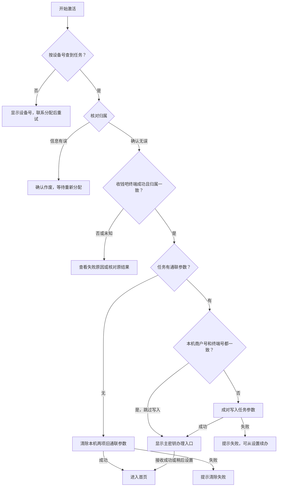
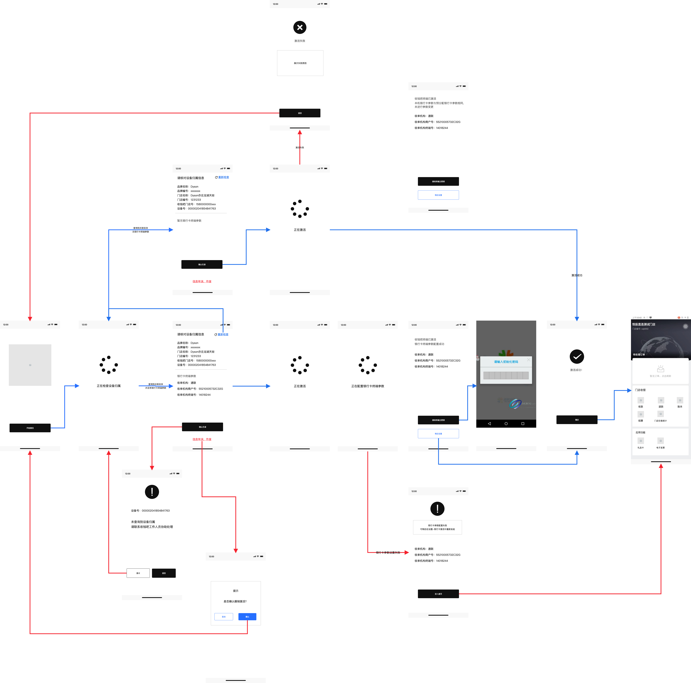
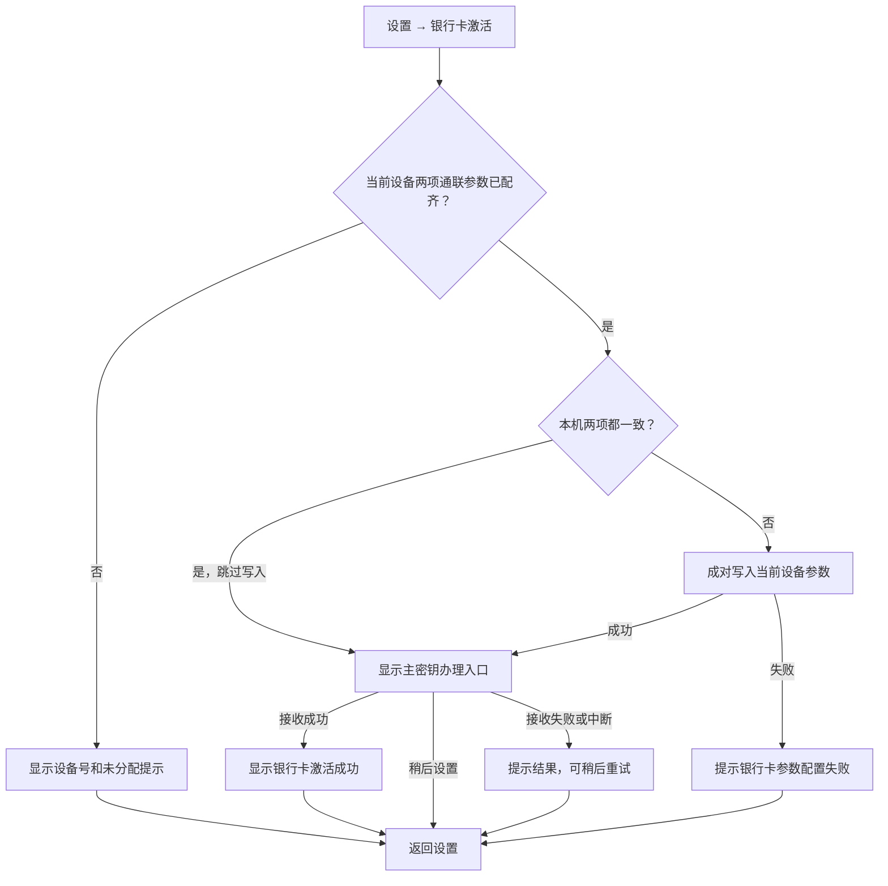

# Meta POS 设备分配与激活改造 PRD

| 版本 | 日期 | 状态 | 读者 |
|---|---|---|---|
| V0.4 | 2026-11-25 | 草稿 | 研发、测试、实施、运营、AE |

[通用规则](#11-通用业务与字段规则) · [任务状态与操作矩阵](#任务状态与操作矩阵) · [运营平台](#31-运营平台) · [Meta POS 端](#32-meta-pos-端操作) · [CRM](#33-crm) · [关键验收](#4-关键验收)

## 1. 方案概览

现有 Meta POS 的扫码激活流程与实际业务流程不匹配。本期在分配环节预先确定设备归属。实施、运营或 AE 先按设备号建立激活任务，现场人员在 POS 上核对归属后激活。收钱吧终端激活成功即可完成任务。通联银行卡按本次配置继续开通，也可以在已有收钱吧终端的设备上从设置页单独办理。

| 业务对象 | 含义与关系 |
|---|---|
| 设备号 | 实物 POS 的识别号，用于分配、现场查找和重新分配。始终按文本处理，保留前导零。 |
| 导入批次 | 运营平台一次上传对应一个批次。批次保留清单、检查结果、分配结果和逐台任务的聚合进度。 |
| 激活任务 | 分配成功后，每台设备生成一条任务。任务记录目标归属、收钱吧激活码和预分配的银行卡参数，保留历次激活结果。 |
| 已激活设备记录 | 新流程中，收钱吧终端激活成功且归属匹配后生成。设备 ID 标识本次设备记录，收钱吧终端号标识本次收钱吧终端。反激活后，实物设备可用同一设备号重新分配，历史任务和结果可查。 |
| 银行卡终端参数 | 预分配参数随激活任务交给 POS 使用。设备激活后的当前参数在设备详情维护。通联终端号与收钱吧终端号分别用于各自的业务。 |

**本期范围**覆盖运营平台的批次导入、任务和设备管理，Meta POS 端的设备与银行卡激活，以及 CRM 的单台分配、任务和设备管理。CRM 以当前销售或 AE 关联的品牌为数据范围。导入批次及整批执行留在运营平台。

新流程的 Meta POS 使用设备号查询任务，取消扫码激活入口。旧轻 POS 设备继续通过现有入口按原流程办理，存量设备迁移及旧流程改造留待后续。CRM 下单、OMS、发货、换修物流和实物回收继续走现有流程。本期通联银行卡开通支持 POS 写入通联 USDK，其他收单机构继续按现有方式配置。

业务场景和角色交接以 [业务 BRD](./meta-pos-device-activation-brd-business.md) 为背景。分配时生成任务、任务完成后生成设备记录、首次激活也先比对 USDK 参数、CRM 暂缓导入批次，采用后续确认口径。[运营平台 Demo](https://lch6s.github.io/spa/pos-device-allocation/)用于核对页面、字段和交互。生产数据由品牌门店关系、激活任务、收钱吧终端及设备服务提供，POS 激活和 USDK 处理由真实终端联调验证。

### 1.1 通用业务与字段规则

#### 1.1.1 字段格式

以下规则用于设备清单导入、运营平台和 CRM 单台分配、修改待处理任务，以及在设备详情维护银行卡终端参数。每个入口校验本次提交的相关字段。编号按文本处理，保留前导零和英文大小写。

| 字段 | 长度 | 允许字符 | 格式错误提示 |
|---|---|---|---|
| 通联商户号 | 15 位 | 数字 `0–9`、大写英文字母 `A–Z`，可混合 | 通联商户号须为 15 位，仅支持数字和大写英文字母。 |
| 通联终端号 | 8 位 | 数字 `0–9` | 通联终端号须为 8 位数字。 |
| 收钱吧激活码 | 8 位 | 数字 `0–9` | 收钱吧激活码须为 8 位数字。 |
| 设备号 | 1–30 位 | 数字 `0–9`、英文字母 `A–Z`、`a–z` | 设备号须为 1–30 位数字或英文字母。 |

通联商户号和终端号均为空时，按未配置处理。只填一项时提示成对填写。两项均有值时分别校验格式。导入错误记入原行的检查结果，单台分配和编辑在相应字段处提示。激活码有效性、门店归属另行校验。 [依赖与待确认](#5-依赖与待确认)

#### 1.1.2 设备号占用与重复办理

- **一个设备号对应一个有效分配或一条有效设备绑定。** 已有待处理任务或仍绑定有效设备时，其他分配应提示占用。原任务作废或设备确认反激活后，设备号恢复可分配。
- **检查和执行分别判断占用。** 批量预览校验当时的设备绑定与门店归属。批量执行及单台提交在建任务前再次校验。不同分配并发占用同一设备号时，只有一笔能创建任务。
- **同一笔业务重复提交时沿用原结果。** 重试批次只接续尚未取得结果的行，已成功行保留原任务。同一次成功激活重复回传时只关联原设备记录。激活结果未知时先查原请求。

#### 1.1.3 提交人与办理人

| 对象或来源 | 「提交人」取值 |
|---|---|
| 导入批次 | 上传设备清单的操作人。 |
| 批量分配生成的激活任务 | 来源批次的上传人。其他同事继续执行或重试时，逐台任务仍显示原上传人。 |
| 单台分配生成的激活任务 | 在运营平台或 CRM 创建该任务的操作人。 |

执行分配、重试、取消、作废等环节分别记录实际办理人及时间。例如，甲上传清单、乙执行分配，批次与生成的任务都显示甲为提交人，执行记录显示乙。

## 2. 端到端路径

### 2.1 实施同事

- **激活设备。** 接到新机或换修的配机需求后，在运营平台上传、检查并执行清单，或单台分配。拿到分配结果后，在 Meta POS 核对门店并激活收钱吧终端，按订单要求开通银行卡及验机。验机通过后发货，门店收货后使用已开通的支付能力。
- **反激活设备。** 收到换修或回收的旧机后，核对设备号和原门店，在运营平台「POS 激活管理」发起反激活。确认原终端解绑后，按现有换修或回收流程处理。需要再次发放时，为该设备创建新任务。

### 2.2 AE 同事

- **协助门店激活。** 在 CRM 核对品牌与目标门店，在所属品牌范围内创建单台激活任务，或查到已有任务，通知店员在 Meta POS 核对归属并激活。回到 CRM 确认任务已完成。遇到激活码异常时，按任务记录修正后通知店员重试。
- **反激活设备。** 接到移机、维护等需求后，在 CRM 查找当前设备并核对归属，办理反激活并确认原终端解绑。需要恢复使用时，按目标门店重新分配，再交给店员激活。
- **查看与维护设备信息。** 在 CRM 查看关联品牌内的设备详情和银行卡参数变更记录。需要后补通联时，成对补录商户号和终端号，通知店员并交接初始化密码。店员从 Meta POS 设置发起银行卡激活并验机。

### 2.3 运营同事

- **协助门店激活。** 在运营平台查找任务，按需要单台分配或继续处理导入批次。确认目标门店后，通知实施或店员在 Meta POS 办理。通过任务结果确认激活是否成功，按失败原因接续处理。
- **反激活设备。** 在运营平台「POS 激活管理」核对设备号及当前归属后发起反激活。确认解绑后，回收场景可结束设备办理。移机或维护场景按本次门店重新分配，再通知现场激活。
- **查看与维护设备信息。** 在运营平台查看设备归属、收钱吧终端、银行卡终端和设备上报信息。需要补录银行卡参数时，核对并保存，再通知现场从 Meta POS 设置继续。参数和操作记录可回查。

## 3. 产品需求

### 3.1 运营平台

实施和运营从「集团客户 → IOT 管理」使用「激活任务管理」和「POS 激活管理」。本模块中，实施与运营可处理全量品牌数据，操作记录到实际办理人。

| 菜单 | 进入后 | 可办理事项 |
|---|---|---|
| 激活任务管理 | 默认进入「导入批次」，可切换到「设备激活任务」 | 上传、检查和执行清单，查批次进度，单台分配，处理逐台任务。 |
| POS 激活管理 | 当前设备列表 | 查设备详情、维护银行卡参数、查变更记录、反激活。 |

#### 3.1.1 上传、检查与执行分配

##### 上传页

从「激活任务管理 → 导入批次」点击「上传设备清单」，进入独立上传页，顶部显示「上传 → 检查 → 执行」。一次成功受理的上传对应一个批次。追加设备时新建批次。 [导入批次原型](https://lch6s.github.io/spa/pos-device-allocation/#allocation)

| 字段或操作 | 页面要求 |
|---|---|
| 刷卡收单机构 | 单选「通联」或「其他」。选择决定模板字段。 |
| 下载模板 | 下载当前收单机构的 Excel 模板。切换机构后按新选项下载。 |
| 批次备注 | 选填，可用品牌、开店批次或发货单号标记，提交后可查询。 |
| 设备清单 | 必须选择一个 `.xlsx` 或 `.xls` 文件。编号按文本填写并保留前导零。 |
| 上传并检查 | 校验文件可读、表头与模板一致，且包含设备行。通过文件级校验后建立批次，进入「检查设备清单」。文件级失败时在上传页展示原因，操作者可替换文件后重试。 |
| 取消 | 返回导入批次列表。 |

| 模板字段 | 通联 | 其他 |
|---|---|---|
| 收钱吧门店号 | 必填 | 必填 |
| 设备号 | 必填 | 必填 |
| 收钱吧激活码 | 必填 | 必填 |
| 通联商户号、通联终端号 | 两项一起填写或一起留空 | 使用三列基础模板 |

##### 逐行检查与预览

系统以清单原行号记录校验结果。一行有多处错误时，一并展示可判定原因。批次初次检查成功后保存该结果，页面退出或刷新后仍能查看。

| 检查项 | 通过条件 | 未通过时展示 |
|---|---|---|
| 基础必填 | 收钱吧门店号、设备号、收钱吧激活码均有值 | 指出缺失字段。 |
| 编号原值 | 输入保留完整编号和前导零 | 科学计数法、长编号失真等格式风险提示按文本填写。 |
| 字段长度和字符 | 设备号、收钱吧激活码及有值的通联参数符合[通用字段格式](#111-字段格式) | 逐项给出格式错误，相关记录进入「导入失败」。 |
| 目标门店 | 收钱吧门店号可唯一匹配既有关联的品牌门店 | 「收钱吧门店号无法唯一匹配品牌门店」。 |
| 通联参数 | 两个号码都填或都空 | 「通联商户号和终端号须成对填写」。 |
| 清单内设备号 | 同一设备号只出现一次 | 重复的各行均提示「同一清单内设备号重复」。 |
| 设备号占用 | 设备号符合[占用规则](#112-设备号占用与重复办理) | 已有任务时显示占用原因。已激活时提示当前归属。 |
| 列及行数据 | 按所选机构模板提交，允许失败清单带末尾的「失败原因」列 | 发现额外数据时标记该行，末尾的已知失败原因列在重传时跳过。 |

激活码有效期和归属能否在分配前校验见 [依赖与待确认](#5-依赖与待确认)。激活时以实际返回的收钱吧门店号校验归属，见 [确认并激活收钱吧终端](#322-确认并激活收钱吧终端)。

| 检查页区域 | 展示内容与可用操作 |
|---|---|
| 批次信息 | 批次号、上传文件、刷卡收单机构、批次备注、提交人（文件上传人）、上传时间、设备记录数。取消后按实际情况显示取消人、取消时间或自动取消原因。 |
| 「设备分配预览」 | 标注通过数量，每台设备一行，按清单顺序展示设备号、品牌名称、品牌编号、门店名称、门店编号、收钱吧门店号、收单机构、通联商户号及通联终端号。 |
| 「导入失败」 | 标注失败数量，列表展示设备号、收钱吧门店号及失败原因。存在通过行时默认显示预览，否则默认显示导入失败。 |
| 待执行批次 | 提供「执行分配（N 台）」和「取消批次」。N 为已通过检查的行数。再次进入本批次可直接续办。 |
| 全部未通过已取消 | 页面右上显示「已取消」，可查看失败原因并下载失败清单。 |

##### 执行、取消与重试

点击「执行分配（N 台）」时，逐条按检查时确认的归属再次校验。门店关联已经变化或设备号被其他操作占用时，该行记为执行失败。符合条件的行各生成一条「待处理」任务，随后通过任务管理接续。

| 批次状态 | 进入条件 | 后续按钮及去向 |
|---|---|---|
| 检查中 | 文件受理，行检查尚未结束 | 从批次列表查看检查进度。执行前可取消批次。 |
| 检查失败 | 检查服务异常或中断 | 提供「重试检查」和「取消批次」。重试使用原批次。 |
| 待执行 | 至少一行通过检查 | 可查看两类检查结果，确认执行或取消。 |
| 执行中 | 收到本批次执行请求 | 查看批次进度。同一批次重复请求沿用原进度。 |
| 执行完成 | 已取得逐行终态 | 进入批次详情，查看逐台任务与失败清单。单行失败仍按明细展示。 |
| 执行失败 | 执行服务异常或中断 | 提供「重试执行」。先核对原结果，已成功行沿用已有任务，只继续处理余下行。 |
| 已取消 | 全部行检查未通过，或操作人确认取消尚未执行的批次 | 保留已产生的检查结果及取消原因或操作信息。通过失败清单修正后新建批次。 |

取消需二次确认。执行结果已落定后，通过对应任务作废撤销单台分配。有权限的实施或运营可接手，批次和逐台任务的提交人均取原上传人。执行和取消由实际操作人留痕。 [提交人与办理人](#113-提交人与办理人)

#### 3.1.2 批次查询、详情与失败清单

##### 批次列表

筛选项为批次号、批次备注、设备号、提交人（文件上传人）、上传时间范围、导入进度。设备号检索原清单，包含失败行。支持搜索、重置和分页。上传时间按北京时间精确到分钟，包含起止分钟，也可只填开始或结束。结束早于开始时在时间条件处提示。

| 顺序 | 列 | 说明 |
|---|---|---|
| 1 | 批次号 | 上传受理后生成的批次编号。 |
| 2 | 文件名 | 原上传文件名。 |
| 3 | 批次备注 | 上传时填写的备注。 |
| 4 | 刷卡收单机构 | 本次上传选用的机构。 |
| 5 | 导入进度 | 批次当前处理阶段。 |
| 6 | 共导入 | 清单设备行数。详见[批次进度统计](#批次进度统计)。 |
| 7 | 待处理 | 待处理任务数。 |
| 8 | 已处理 | 已完成任务数。 |
| 9 | 导入失败 | 检查或执行失败的行数。 |
| 10 | 已作废 | 已作废任务数。 |
| 11 | 提交人 | 文件上传人。 |
| 12 | 上传时间 | 原文件提交时间。 |
| 13 | 操作 | 「查看详情」，进入当前阶段的详情。 |

##### 批次详情

| 区域 | 字段及操作 |
|---|---|
| 执行后的批次详情 | 展示批次号、上传文件、刷卡收单机构、批次备注、提交人（文件上传人）、上传时间及五项进度统计，下设「设备激活任务」「导入失败」页签。有任务时默认展示任务页签，否则默认展示失败页签。 |
| 设备激活任务页签 | 查看本批逐台任务，支持按设备号、任务状态搜索及分页。任务详情、单条作废和批量作废沿用 [单台分配与激活任务管理](#313-单台分配与激活任务管理)。 |
| 导入失败页签 | 展示设备号、收钱吧门店号、失败阶段和失败原因。阶段区分「检查未通过」和「执行失败」。有失败行时提供「下载失败清单」。 |

##### 批次进度统计

| 批次统计 | 口径 |
|---|---|
| 共导入 | 本批次上传的非空设备行数，含后续检查未通过的行。 |
| 待处理 | 已生成任务、任务状态为「待处理」的设备数。可重试失败或结果待核对的任务计在这里。 |
| 已处理 | 本批次中任务已完成的设备数，反激活后仍保留该批次的历史完成结果。 |
| 导入失败 | 检查未通过与执行失败的行数。批次级服务异常由导入进度展示。 |
| 已作废 | 已生成任务且任务已作废的设备数，单独统计。 |

执行完成后，五项统计满足「共导入 = 待处理 + 已处理 + 导入失败 + 已作废」。例如上传 4 行，1 行检查未通过，1 行执行时冲突，2 行建成待处理任务，结果为共导入 4、待处理 2、已处理 0、导入失败 2、已作废 0。后续其中一台激活，另一台作废时，待处理为 0、已处理为 1、导入失败仍为 2、已作废为 1。查询该批次的办理进度即可，无需人工办结。

##### 失败清单下载与重传

- **下载。** Excel 仅包含失败行，字段按对应机构的原模板顺序输出，末列增加「失败原因」。两种失败阶段在批次页面区分。
- **重传。** 操作者更正原数据列，选择相同机构作为新批次上传。系统忽略末列旧原因并重新检查，新旧批次各保留自己的结果。

#### 3.1.3 单台分配与激活任务管理

##### 单台分配

「设备激活任务」页右上角提供「单台分配」。弹窗单列展示以下字段，自上而下录入。 [设备激活任务原型](https://lch6s.github.io/spa/pos-device-allocation/#tasks)

| 字段 | 输入与校验 |
|---|---|
| 收钱吧门店号 | 必填。唯一命中后回显只读的品牌名称、品牌编号、门店名称、门店编号及收钱吧门店号。修改门店号后重新查询归属。 |
| 设备号 | 必填，提示「请输入 POS 设备号」。校验[字段格式](#111-字段格式)及[设备号占用](#112-设备号占用与重复办理)。错误或冲突原因显示在设备号处。 |
| 收钱吧激活码 | 必填，输入目标门店对应的 8 位数字激活码。归属预校验见 [依赖与待确认](#5-依赖与待确认)。 |
| 刷卡收单机构 | 选择「通联」或「其他」。 |
| 通联商户号、通联终端号 | 选择通联时显示。按[通用字段格式](#111-字段格式)校验成对填写及各自格式。 |
| 确认分配 | 提交时重新核对门店归属及设备号占用。校验失败保留已输入的信息，并提示原因。成功后生成一条来源为「单台分配」的待处理任务。 |

创建成功弹窗提示「设备激活任务创建成功」。「返回」关闭弹窗。「查看详情」进入任务列表，并显示刚创建的任务。

##### 任务状态与操作矩阵

任务列表及状态筛选仍使用「待处理」「已完成」「已作废」。待处理任务按是否存在未决激活或解绑结果区分操作权限。POS、运营平台和 CRM 共用以下规则，CRM 同时校验品牌权限。

| 状态或子状态 | 发起激活 | 修改激活码 | 编辑预分配参数 | 单条作废 | 批量作废 |
|---|---|---|---|---|---|
| 待处理 · 可办理 | 允许 | 允许 | 允许 | 允许 | 可勾选并提交 |
| 待处理 · 激活结果待核对 | 拦截 | 拦截 | 拦截 | 拦截 | 跳过该台 |
| 待处理 · 错绑待解绑 | 拦截 | 拦截 | 拦截 | 拦截 | 跳过该台 |
| 已完成 | 拦截 | 拦截 | 拦截 | 拦截 | 跳过该台 |
| 已作废 | 拦截 | 拦截 | 拦截 | 拦截 | 跳过该台 |

- **进入可办理。** 初次分配成功，或原激活确认失败且无未解除的绑定时，可继续处理原任务。
- **进入激活结果待核对。** 已发起激活且尚未拿到明确结果，包括办理中及超时未知。现场接续原请求。确认成功且归属一致后转已完成，确认未激活后恢复可办理，确认错绑后进入错绑待解绑。
- **进入错绑待解绑。** 已确认绑定门店有误且原终端解绑未确认。系统自动处理，允许核对或重试原解绑。确认解绑后恢复可办理。
- **完成或作废。** 激活成功且归属匹配时生成设备记录，任务已完成。确认作废后任务已作废，释放有效分配。
- **页面与提交校验。** 拦截时收起修改与单条作废入口，批量模式下该台不可勾选。POS 只接续核对或等待原结果。服务端按最新状态拦截提交，包括从旧页面发起的操作。批量提交时，状态变化的单台跳过，其余符合条件的台数照常处理。

##### 任务查询与详情

| 区域 | 内容 |
|---|---|
| 全局任务筛选 | 设备号、品牌名称或编号、门店名称或编号、任务状态、来源、批次号、生成时间范围。门店搜索也支持收钱吧门店号。来源为单台分配、批量分配。支持搜索、重置和分页，时间范围沿用批次列表的分钟口径。 |
| 任务列表 | 按顺序展示生成时间、设备号、目标品牌、目标门店、来源、批次号、任务状态、最近激活结果、操作。单台任务的批次号显示「—」。每行均可「查看任务详情」，符合条件的待处理任务可作废。 |
| 最近激活结果 | 无尝试时显示「—」。成功时显示激活成功。失败时显示最近一次原因，结果待核对或错绑解绑待处理时展示相应提示。已作废时显示作废原因。 |
| 任务信息 | 设备号、任务编号、任务状态、分配时间、批次号、作废信息及提交人。分配时间与列表「生成时间」口径一致。批量任务显示原文件上传人，单台任务显示该任务创建人。 |
| 目标门店 | 品牌名称、品牌编号、门店名称、门店编号、收钱吧门店号、脱敏的收钱吧激活码。可编辑时，在激活码旁提供「修改激活码」。 |
| 预分配银行卡终端参数 | 展示刷卡收单机构、商户号和终端号。可编辑时提供「编辑」，改动保存到当前任务。 |

##### 修改与作废

| 操作 | 可用条件与成功结果 |
|---|---|
| 修改激活码 | 按[操作矩阵](#任务状态与操作矩阵)判断入口。弹窗校验新激活码为 8 位数字，保存后 POS 重新检查时使用新值。 |
| 编辑预分配银行卡参数 | 弹窗展示当前收单机构及参数。按[通用字段格式](#111-字段格式)校验成对填写及各自格式，保存后详情回显。 |
| 单条作废 | 在符合条件的待处理行或任务详情点击「作废」。填写原因并确认后，任务进入「已作废」，记录操作人、时间和原因，设备号可重新分配。 |
| 批量作废 | 全局和批次详情入口的选择和提交行为一致。逐台按[操作矩阵](#任务状态与操作矩阵)校验。 |

更换目标门店或设备号时，先作废原任务，再重新分配。提交期间发生状态变化时提示刷新后处理。

1. **进入。** 默认隐藏勾选框。点「批量作废」显示勾选框、已选数量及操作栏。
2. **选择。** 「选中全部」覆盖当前筛选结果中的可作废任务，翻页保留勾选。「全部取消」清空勾选。「取消操作」清空勾选并退出批量模式。
3. **提交。** 点「确认作废」填写原因并提交。按最新状态逐台确认可作废范围。
4. **结果。** 展示已作废数量和未处理项。所选任务按实际结果更新，批次导入进度沿用原执行结果。

##### 激活记录与异常接续

记录按时间从新到旧列出激活尝试。尚未激活时显示「暂无激活记录」。列为激活时间、结果、设备 ID、收钱吧终端号、原因、解绑情况和操作。

| 记录结果 | 设备 ID、收钱吧终端号 | 原因及解绑情况 | 后续操作 |
|---|---|---|---|
| 成功且终端仍绑定 | 展示本次成功生成的标识 | 原因、解绑情况显示「—」 | 「设备详情」。 |
| 成功后反激活 | 保留本次成功的历史标识 | 解绑情况显示「已解绑」 | 从任务中查历史结果。 |
| 普通失败 | 两列显示「—」 | 展示实际原因，解绑情况显示「—」 | 可修正事项在原任务接续。 |
| 实际门店不符 | 两列显示「—」 | 原因展示「实际激活门店与任务目标门店不一致」和实际收钱吧门店号。自动解绑完成前后，解绑情况均显示「—」 | 系统自动解绑。异常或结果未知时，从任务详情核对或重试解绑，确认解除后继续。 |
| 结果待确认 | 两列显示「—」 | 展示待核对的原因，解绑情况显示「—」 | 核对上次结果，确认后接续原任务。 |

运营平台和 CRM 展示正式激活结果。Demo 中的「模拟 POS 激活」与模拟结果选择用于原型验证。

#### 3.1.4 POS 激活管理与银行卡参数维护

##### 设备列表

按设备 ID、设备号、收钱吧终端号、品牌名称或编号、门店名称或编号、设备状态查询。门店搜索也支持收钱吧门店号。新流程设备在激活成功后进入列表，待处理记录从任务列表办理。旧流程中未激活设备的列表操作沿用既有页面。 [POS 激活管理原型](https://lch6s.github.io/spa/pos-device-allocation/#devices)

| 顺序 | 列 | 说明 |
|---|---|---|
| 1 | 状态更新时间 | 设备状态最后变更时间。 |
| 2 | 设备 ID | 当前设备记录标识。 |
| 3 | 设备号 | 实物设备编号。 |
| 4 | 设备类型 | 设备类型信息。 |
| 5 | 收钱吧终端号 | 当前绑定的收钱吧终端号。 |
| 6 | 应用版本 | 设备的应用版本。 |
| 7 | 品牌名称 | 当前设备归属品牌。 |
| 8 | 门店名称 | 当前设备归属门店。 |
| 9 | 设备状态 | 根据设备当前状态显示。 |
| 10 | 操作 | 查看详情。旧流程按现有条件提供列表操作。 |

##### 设备详情

| 设备详情区域 | 展示或操作 |
|---|---|
| 设备信息 | 设备 ID、创建时间、状态更新时间、设备状态、设备号、设备类型。 |
| 设备归属 | 品牌名称、品牌编号、门店名称、门店编号。 |
| 收钱吧终端信息 | 收钱吧终端号，收钱吧商户名和商户号，收钱吧门店名和门店号。 |
| 银行卡终端信息 | 收单机构、机构商户号、机构终端号。提供「编辑」「变更记录」。 |
| 设备上报信息 | 沿用现有上报字段及展示规则，缺少上报时显示「无上报信息」。 |

详情可返回列表和对已激活设备发起反激活。激活记录在任务详情查看。删除功能只保留在原流程所需的列表行入口。

##### 反激活设备

1. **发起。** 在已激活设备详情点击「反激活」，弹窗展示设备号和解绑影响。取消时留在设备详情。
2. **确认。** 确认后提交解除原收钱吧终端绑定，等待原请求结果。
3. **成功。** 确认解绑后，解除原记录的有效设备号关联和银行卡配置。设备退出当前列表，设备号可重新分配。历史任务保留原设备 ID、终端号和激活结果，成功记录显示「已解绑」。
4. **异常。** 解绑失败或结果未知时，提示核对或继续处理原请求。确认解绑成功后才释放设备号。 [POS 端续办](#325-设备反激活后在-pos-重新办理)

##### 维护银行卡参数

- **打开与校验。** 点击「编辑」，回显设备号、品牌、门店和当前配置。配置选项为「通联」和「暂不配置银行卡」。选通联时校验两项成对填写及各自格式。 [通用字段格式](#111-字段格式)
- **保存。** 保存后设备详情回显当前配置，现场下一次从设置发起银行卡激活时读取新值。原任务保留预分配信息。校验或保存失败时保留表单输入，提示修正或重试。

##### 查看银行卡参数变更记录

- 从银行卡终端信息区域打开宽弹窗，按时间从新到旧展示时间、操作人、操作端、变更前、变更后。
- 首次由任务写入设备的通联配置记为「系统」，操作端显示「—」，变更前显示「初始配置」。有值变化的手工保存记录实际操作人和操作端。
- 变更前、变更后分别按收单机构、商户号、终端号分三行显示。没有历史时显示「暂无变更记录」。

### 3.2 Meta POS 端操作

#### 3.2.1 开始激活并核对设备归属

正常激活的分支如下。查询、异常及通联配置细节见本节和[银行卡操作](#323-收钱吧终端激活后的银行卡操作)。

展开正常激活界面参考图

[查看正常激活原图](./assets/meta-pos-device-activation-prd/pos-device-activation.png)

图中「查询到关联实体」对应查询待处理任务，「撤销激活」对应作废任务。参数一致后接续主密钥、无预分配参数时清除本机旧值，均按上方分支和正文办理。

入口为未激活的 Meta POS。实施或店员点击「开始激活」后，POS 用本机设备号查询任务，用户看到「正在检查设备归属」。

| 查询结果或用户操作 | 页面字段和提示 | 下一步 |
|---|---|---|
| 查到待处理任务 | 「请核对设备归属信息」。按顺序展示品牌名称、品牌编号、门店名称、门店编号、收钱吧门店号和本机设备号。银行卡区域展示预分配的收单机构、机构商户号和机构终端号，或「暂无银行卡终端参数」。 | 信息一致点「确认无误」。信息有误可重新检查或作废。 |
| 查无有效分配 | 展示本机设备号及「未查询到设备归属」，提示联系实施、运营或 AE。 | 「重试」再次查本机分配，「返回」回到开始激活。 |
| 查询异常 | 展示查询失败，允许重试。 | 查询成功后按实际结果继续。 |
| 点「重新检查」 | 重新读取本机的现行任务和参数。 | 有有效任务时重新核对。任务已变化时按最新结果显示。 |
| 点「信息有误，作废」 | 二次确认本机待处理任务。 | 确认后任务作废，返回激活入口，等待重新分配。取消确认时回到核对页。 |

本页的银行卡参数来自待处理任务。收钱吧激活码由任务提供给激活流程，现场人员在本页核对归属和展示参数。

#### 3.2.2 确认并激活收钱吧终端

现场人员点「确认无误」后，POS 使用当前有效任务的收钱吧激活码发起，并显示「正在激活」。办理期间等待原结果。任务已作废或关键信息在核对后发生变化时，提示重新检查，现场核对最新内容后再发起。

返回的终端归属与任务目标一致时，POS 显示收钱吧终端已激活并按 [收钱吧终端激活后的银行卡操作](#323-收钱吧终端激活后的银行卡操作) 接续。后台任务同步显示「已完成」，设备记录与任务成功结果关联。本次银行卡仍处于参数处理或主密钥办理阶段时，POS 使用相应状态文案。

| POS 上的结果 | 现场人员怎么继续 |
|---|---|
| 激活码无效、过期或已知属于其他门店 | 进入「激活失败」页，展示原因，「返回」回到激活入口。实施、运营或有权限的 AE 修正原任务后，现场人员重新检查并重试。 |
| 网络或服务超时，结果未知 | 提示原激活结果待核对。再次进入时接续原请求，确认成功后继续核对实际门店，确认未激活后可重试。 |
| 收钱吧终端实际门店与目标不一致 | 进入「激活失败」。实际错绑门店号和自动解绑处理在后台任务详情查看。待解绑期间继续查询处理进度，确认解除后再发起。 |

#### 3.2.3 收钱吧终端激活后的银行卡操作

收钱吧终端激活成功后，POS 使用本次激活任务的预分配参数。设备在移机、维护或重新发放后再次激活时，也按本节处理。

| 本次任务与本机 USDK 参数 | POS 处理 | 现场看到什么、可做什么 |
|---|---|---|
| 通联参数齐全，本机的商户号和终端号逐项一致 | 跳过写入，沿用本机参数 | 显示收钱吧终端已激活和参数一致，并回显收单机构、商户号和终端号。可点「接收终端主密钥」或「稍后设置」。 |
| 通联参数齐全，本机缺失或任一项不同 | 成对写入任务中的通联商户号和终端号 | 写入时显示「正在配置银行卡终端参数」。成功后回显三项参数，提供「接收终端主密钥」和「稍后设置」。 |
| 本次无通联预分配参数 | 主动调用 USDK 清除本机旧通联商户号、终端号 | 确认清除后以收钱吧终端已激活结束，可进入首页。空值或 `00` 以 [依赖与待确认](#5-依赖与待确认) 联调结果为准。 |
| 参数读写失败 | 保留收钱吧终端激活结果，记录银行卡配置异常 | 显示「银行卡参数配置失败」，可先进入首页，稍后从设置重新办理。同一份配置须在可确认的写入结果下继续。 |
| 旧参数清除失败 | 保留收钱吧终端激活结果，按清除异常处理 | 明确提示旧银行卡参数清除失败。在旧参数失效前，须避免沿用其刷卡。终端拦截方式见 [依赖与待确认](#5-依赖与待确认)。 |

| 主密钥操作 | 反馈与去向 |
|---|---|
| 接收终端主密钥 | 唤起通联界面，由现场人员输入初始化密码。收到成功结果后显示「银行卡激活成功」，确认后进入首页。 |
| 稍后设置 | 显示收钱吧终端已激活、银行卡待开通，可进入首页。 |
| 接收主密钥失败或中断 | 按通联回执提示失败或中断，可从设置续办。详细返回值待联调。 |

银行卡流程与收钱吧终端分开判断。银行卡暂缓、参数配置失败或主密钥未完成时，后台任务仍按收钱吧终端的激活结果展示。

交付给门店前，实施按订单备注或派机清单验机。已提供成对通联参数时，须完成收钱吧终端和银行卡的激活及验机后发货。缺初始化密码的设备等银行卡开通后发货。未提供完整通联参数时，可在收钱吧终端激活并验机后先发货，后续由 AE 或运营协助门店开通。

#### 3.2.4 设置页单独发起银行卡激活

设置页读取当前设备的最新配置，办理结束回到设置。

展开设置页银行卡激活界面参考图

[查看设置页银行卡激活原图](./assets/meta-pos-device-activation-prd/pos-settings-bank-card-activation.png)

图中成功页的「进入首页」在本流程对应「返回设置」。已一致的参数直接接续主密钥环节。

收钱吧终端已激活后，现场人员可从「设置 → 银行卡激活」发起或重试。每次点击时，POS 按当前有效设备读取后台维护的最新银行卡终端参数，然后和本机通联 USDK 的商户号和终端号逐项比对。保存后台参数后，下一次点入口读取新值。

| 参数或结果 | POS 页面和后续操作 |
|---|---|
| 当前设备未配置完整通联参数 | 展示设备号及「当前设备未分配银行卡终端参数」。「确定」返回设置，AE 或运营补录后通知现场再次发起。 |
| 当前参数齐全且两项都一致 | 跳过写入，回显当前参数，进入接收终端主密钥步骤。 |
| 当前参数齐全但本机缺失或任一项不一致 | 成对写入当前设备参数。写入成功后显示机构、商户号和终端号，用户可点「接收终端主密钥」或「稍后设置」。 |
| 参数配置失败 | 显示设备号和配置失败原因。「确定」后回到设置，可稍后重新发起。 |
| 主密钥接收成功 | 显示「银行卡激活成功」，确认回到设置，现场可验证刷卡。 |

整个设置页流程沿用已激活设备的收钱吧终端号。操作结果由参数配置和接收主密钥两步分别反馈。参数配置成功后才可继续接收主密钥，接收成功后才显示银行卡激活成功。

#### 3.2.5 设备反激活后在 POS 重新办理

运营平台或 CRM 确认解绑后，POS 自动识别反激活并回到未激活页面，现场人员无需重启。检测触发时机、在线生效时限及离线恢复行为由 POS 与服务端联调确认。 [依赖与待确认](#5-依赖与待确认)

点「开始激活」时，以同一实物设备号查询最新有效任务。收到重新分配通知后，现场人员核对新品牌、门店和参数后继续办理。尚未重新分配时，可等新任务就绪后重试。 [核对设备归属](#321-开始激活并核对设备归属) · [银行卡操作](#323-收钱吧终端激活后的银行卡操作)

### 3.3 CRM

#### 3.3.1 激活任务管理

CRM 的「激活任务管理」进入后直接展示设备激活任务列表，右上角提供「单台分配」。以下交互复用 [单台分配与激活任务管理](#313-单台分配与激活任务管理)，并在读取和提交时按 [品牌数据权限](#333-品牌数据权限) 校验品牌。

| 区域 | CRM 可见内容与动作 |
|---|---|
| 列表与筛选 | 展示当前销售或 AE 有权处理的逐台任务。字段和筛选沿用运营平台任务列表，包含运营平台批量生成的任务。支持按来源、批次号及生成时间等条件排查。 |
| 单台分配 | 输入收钱吧门店号后，只回显可操作品牌的门店信息。通过设备号占用及任务字段校验后建立单台任务，创建结果可在此列表追踪。 |
| 任务详情 | 查看任务信息、目标门店、预分配银行卡参数和历史激活结果。待处理且满足状态条件时，可修改激活码、预分配参数或作废。成功记录仍对应有效设备时，可在 CRM 打开设备详情。 |
| 批量作废 | 仅在逐台任务列表勾选。选择、填写原因、确认和反馈沿用运营平台任务交互，以逐台校验结果为准。 |
| 批次号 | 来源为批量分配时展示批次号，供筛选或与运营平台对照。批次详情、导入、整批执行和失败清单下载由运营平台承接。 |

#### 3.3.2 POS 激活管理

| 区域 | CRM 可见内容与动作 |
|---|---|
| 设备列表 | 展示当前销售或 AE 有权查看的已激活设备。按设备号、设备 ID、收钱吧终端号、品牌、门店及状态查找。 |
| 设备详情 | 复用设备信息、归属、收钱吧终端、银行卡终端和上报信息区块。银行卡终端区域可「编辑」和查看「变更记录」。 |
| 反激活 | 在当前设备详情二次确认并提交。确认解绑后设备退出有效列表，任务历史仍可查。现场按 [设备反激活后在 POS 重新办理](#325-设备反激活后在-pos-重新办理) 继续。 |
| 参数维护 | 编辑当前设备的银行卡配置并保存，变更记录注明实际操作人及操作端 CRM。AE 通知现场从设置页使用最新配置继续，见 [设置页单独发起银行卡激活](#324-设置页单独发起银行卡激活)。 |

反激活和参数维护的校验、保存与变更记录沿用 [POS 激活管理与银行卡参数维护](#314-pos-激活管理与银行卡参数维护)。

#### 3.3.3 品牌数据权限

数据范围为当前登录销售或 AE 已关联的品牌。品牌范围内可查询其他同事创建的任务和设备。服务端先过滤数据范围，再返回筛选结果及分页数量。查看详情或提交操作时按最新品牌关系校验。

| 对象或操作 | 校验依据与结果 |
|---|---|
| 查询、编辑、作废激活任务 | 按任务目标品牌校验。无关联品牌时列表为空。通过直达链接查无权任务时拒绝返回详情。 |
| 查询设备、反激活、维护银行卡参数及查看变更记录 | 按设备当前归属品牌校验。设备已退出有效列表或品牌关系变化时，原链接及已打开页面的后续提交按当前结果处理。 |
| 单台分配 | 按输入的收钱吧门店号解析目标品牌。超出当前范围时在门店字段提示不可操作，拒绝创建任务。 |
| 批量作废 | 每台分别校验品牌与任务状态。符合条件的任务继续处理，反馈实际成功和未处理数量。越权项提示无权操作，避免展示超出范围的设备明细。 |

CRM 错绑原因涉及未授权的实际门店号时，其字段是否对有权查看任务的 AE 可见见 [依赖与待确认](#5-依赖与待确认)。评审稿按该字段受品牌数据范围校验处理。

例如运营平台的一笔批次同时为 A、B 两个品牌生成任务，当前 AE 只关联 A。使用同一批次号搜索时，只返回 A 的任务，筛选数量也按 A 计算。直接打开 B 的任务或设备详情、为 B 门店分配，均由权限校验拒绝。若打开 A 的页面后失去该品牌权限，提交修改时按最新权限拒绝。

## 4. 关键验收

### 4.1 运营平台（批次、任务、设备）

| 对应能力 | 条件 | 动作或事件 | 可观察结果 |
|---|---|---|---|
| [多门店清单](#311-上传检查与执行分配) | 清单中有多个有效品牌门店 | 上传并检查 | 每台设备占一行，品牌、门店名称与编号、收钱吧门店号及收单参数可在同一行核对。 |
| [文件级失败](#311-上传检查与执行分配) | 上传文件表头与所选模板不一致 | 点「上传并检查」 | 上传页指出模板问题，批次列表无该次提交的新增批次。 |
| [字段格式](#311-上传检查与执行分配) | 清单中有 31 位或含连字符的设备号、7 位激活码、含小写字母的 15 位通联商户号，或含字母的 8 位通联终端号 | 上传并检查 | 各对应记录进入「导入失败」，展示具体字段的格式要求。 |
| [前导零](#311-上传检查与执行分配) | 设备号为 `000123Ab`，激活码及通联终端号为 `01234567`，商户号为 `0000000000000A1`，均按文本填写 | 导入或单台分配 | 格式校验通过，字段保留前导零及原字母大小写。 |
| [全部未通过](#311-上传检查与执行分配) | 每一行均检查失败 | 检查完成 | 批次显示「已取消」，详情有逐行原因，可下载失败清单。 |
| [部分通过](#311-上传检查与执行分配) | 合法行和非法行混合 | 确认执行 | 通过且执行成功的行各生成一条任务，失败行可单独查看。 |
| [批次续办](#311-上传检查与执行分配) | 实施甲完成检查后离开页面，实施乙有权办理 | 实施乙重新打开原批次并执行 | 可查看原检查结果，批次和新任务都显示甲为提交人，执行记录显示乙为执行人。 |
| [执行时冲突](#311-上传检查与执行分配) | 预览通过后设备被另一批或单台分配占用 | 执行原批次 | 冲突行进入「执行失败」，其他有效行正常生成任务。 |
| [执行异常重试](#311-上传检查与执行分配) | 批次执行中断，已有部分行分配成功 | 核对原结果后重试 | 已成功行保留原任务，剩余行以本次执行结果为准。 |
| [导入失败与下载重传](#312-批次查询详情与失败清单) | 存在检查未通过和执行失败的记录 | 查看检查及执行结果，下载失败清单后修正重传 | 两页均使用「导入失败」页签，列表去掉清单行号。执行后仍可查失败阶段。下载文件仅含失败记录，末列为失败原因。重传生成新批次，原结果可查。 |
| [时间范围](#312-批次查询详情与失败清单) | 记录生成或上传时间落在起止分钟 | 使用时间筛选 | 边界记录可查，反向区间在表单内提示。 |
| [单台分配](#313-单台分配与激活任务管理) | 门店归属有效、设备号可用 | 确认分配 | 创建一条待处理任务，当前创建人显示为提交人，生成时间可查。 |
| [修改激活码校验](#313-单台分配与激活任务管理) | 待处理任务已有有效格式的激活码 | 尝试将激活码改为 9 位数字 | 在激活码字段提示须为 8 位数字，任务保留原值。 |
| [设备号占用](#313-单台分配与激活任务管理) | 相同设备号已有待处理任务或仍绑定有效设备 | 发起另一笔单台分配 | 提示占用原因，仍只有原有效分配或绑定。 |
| [批量作废](#313-单台分配与激活任务管理) | 跨页勾选的任务中有设备刚发起激活 | 确认作废 | 其余符合条件的任务作废并单独统计，结果未确认的任务等待核对。 |
| [待核对激活结果](#任务状态与操作矩阵) | 原激活已发起且结果未明 | 尝试再次激活、修改激活码、编辑预分配参数、单条作废或批量作废 | POS 接续原结果。运营平台和 CRM 收起相应入口且该台不可勾选，直接提交也被服务端拦截。 |
| [错绑待解绑](#任务状态与操作矩阵) | 错误绑定的解绑结果尚未确认 | 尝试再次激活、编辑或作废任务 | 拦截操作。确认解绑后，原任务恢复可办理。 |
| [参数变更记录](#314-pos-激活管理与银行卡参数维护) | 已保存设备的初始银行卡配置 | 运营或 AE 保存另一组参数 | 详情可查操作前后值、时间、操作人和对应端。系统初始配置的操作端为「—」。 |
| [参数维护校验](#314-pos-激活管理与银行卡参数维护) | 在运营平台或 CRM 编辑当前设备的通联参数 | 通联终端号输入 7 位数字后保存 | 在相应字段提示须为 8 位数字，当前配置与变更记录保持原值。 |

### 4.2 Meta POS 端

| 对应能力 | 条件 | 动作或事件 | 可观察结果 |
|---|---|---|---|
| [无任务](#321-开始激活并核对设备归属) | 设备号当前无有效分配 | 在 POS 点「开始激活」 | 显示设备号和联系提示，后台完成分配后可重试。 |
| [归属有误](#321-开始激活并核对设备归属) | POS 已查到待处理任务 | 点「信息有误，作废」并确认 | 原任务已作废并释放设备号，POS 回到激活入口。 |
| [激活码修正](#322-确认并激活收钱吧终端) | 激活码过期 | 后台修改并在 POS 重新检查 | 同一条待处理任务使用新激活码，旧失败记录可查。 |
| [激活成功](#322-确认并激活收钱吧终端) | 实际门店等于目标门店 | 确认并激活 | 任务已完成，设备进入设备列表。任务记录的设备 ID 和收钱吧终端号与设备详情一致。 |
| [结果未知](#322-确认并激活收钱吧终端) | 激活请求超时 | 再次打开激活流程 | POS 或后端查原结果，确认失败后才可重试。确认成功时承接原结果。 |
| [自动解除错绑](#322-确认并激活收钱吧终端) | 实际门店与目标不一致 | 收到终端激活结果 | 记录失败并展示实际收钱吧门店号，系统发起解绑。该行「解绑情况」显示「—」。 |
| [首次参数一致](#323-收钱吧终端激活后的银行卡操作) | 任务中两项通联参数齐全，本机两项都一致 | 完成收钱吧终端激活 | 跳过 USDK 参数写入，直接进入接收主密钥。 |
| [首次参数不一致](#323-收钱吧终端激活后的银行卡操作) | 任务中两项齐全，本机任一项不同 | 完成收钱吧终端激活 | 成对写入任务参数，写入成功后进入主密钥环节。 |
| [旧机无新参数](#323-收钱吧终端激活后的银行卡操作) | 本次任务无通联参数，本机留有旧参数 | 完成收钱吧终端激活 | 调用 USDK 清除本机两项，旧参数失效后进入首页。 |
| [稍后设置](#323-收钱吧终端激活后的银行卡操作) | 收钱吧终端成功，通联参数已配置，尚未接收主密钥 | 点「稍后设置」 | POS 显示银行卡待开通，可进入首页，后台任务保持已完成。 |
| [参数写入失败](#323-收钱吧终端激活后的银行卡操作) | 收钱吧终端已激活且通联写入失败 | 等待配置结果 | POS 显示配置失败和设置页续办指引，任务仍为已完成。 |
| [设置页参数缺失](#324-设置页单独发起银行卡激活) | 当前设备缺少完整通联参数 | 从设置发起银行卡激活 | 提示设备号和未分配参数。后台补齐后可从设置再次办理。 |
| [设置页参数一致](#324-设置页单独发起银行卡激活) | 当前设备和本机 USDK 的通联参数逐项一致 | 从设置发起银行卡激活 | 直接进入接收主密钥，保留本机参数及当前收钱吧终端号。 |
| [补录后开通](#324-设置页单独发起银行卡激活) | AE 或运营在设备详情补齐参数 | 现场从设置发起银行卡激活 | 使用当前设备最新参数比对，按需成对写入，再接收主密钥，收钱吧终端号保持原值。 |
| [反激活与移机](#325-设备反激活后在-pos-重新办理) | 设备已成功激活 | 后台反激活并确认解绑 | 设备退出有效列表，成功的历史记录显示「已解绑」。重新分配后，POS 无需重启即可按新任务核对。 |

### 4.3 CRM 与品牌权限

| 对应能力 | 条件 | 动作或事件 | 可观察结果 |
|---|---|---|---|
| [CRM 品牌隔离](#33-crm) | AE 只关联 A 品牌，原运营批次包含 A、B | 按批次号搜索或直达 B 任务、设备 | CRM 仅能查询及处理 A 的任务与设备。B 的详情与提交操作均被拒绝。 |
| [权限变化](#333-品牌数据权限) | AE 打开 A 设备的详情后，A 从其关联品牌中移除 | 提交银行卡参数修改 | 服务端拒绝该次修改，设备参数和变更记录保持原值。 |

## 5. 依赖与待确认

| 状态及事项 | 影响路径 | 确认方 | 关闭所需证据 |
|---|---|---|---|
| OPEN · 收钱吧激活码的归属预校验 | 批量检查、单台分配、激活码修改时能否提前识别错误门店。 | 收钱吧终端能力方、Meta 后端 | 能区分有效、过期、错误及其他门店激活码的可用接口和实际返回结果。 |
| OPEN · 收钱吧终端结果核对与解绑 | 超时、错绑、反激活时的业务结果及恢复。 | 收钱吧终端能力方、Meta 后端、POS 研发 | 成功返回实际门店号、核对原激活结果、自动解绑及解绑失败后恢复的联调结果。 |
| OPEN · POS 自动检测反激活 | 后台解绑确认后，POS 在何时感知并回到未激活页面。 | POS 研发、Meta 后端 | 确认校验触发机制、在线生效时限及离线恢复行为。提供在线、离线恢复和无需重启的实测结果。 |
| OPEN · 通联 USDK 参数清除与主密钥结果 | 两项读写比对、旧参数失效、清除失败后拦截旧配置、接收主密钥失败后续办。 | POS 研发、通联对接方 | 支持机型上的读写和清除实测，明确空值或 `00`、旧参数失效判据、异常反馈和主密钥结果。 |
| OPEN · CRM 品牌关系及错绑明细可见性 | 数据范围的来源，以及实际错绑门店超出授权时是否显示其门店号。 | CRM 产品、研发、权限负责人 | 确认可用的销售或 AE 品牌关系、权限变更生效方式，以及跨授权错绑字段的展示规则。 |
